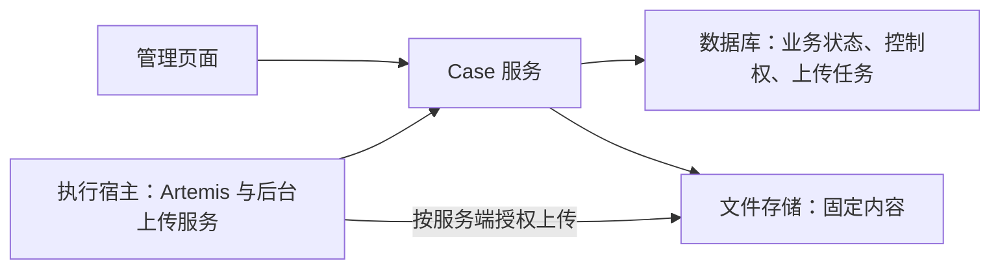

# Artemis Case 管理系统设计

状态：设计稿。产品约束来自已确认的讨论；实现方式与第一版范围采用本文方案。上线前仍需确定的事项集中在第 9 节。

Case 是围绕一个测试目标长期积累的工作记录，包含消息、计划、执行历史、证据和产物。系统以云端为权威，通过独占控制保证同一 Case 只有一条推进主线，通过自动上传保护执行过程中产生的数据。

## 1. 产品规则与范围

| 主题 | 规则 |
|---|---|
| 权限 | 用户修改自己的 Case，按授权范围读取他人的 Case；加入测试批次不增加 Case 写权限 |
| 多设备 | 同一 Case 同时只有一个用户会话可修改；所有者可以明确切换控制设备 |
| 在线要求 | 无法连接 Case 服务时禁止新写入；仅页面掉线而执行器仍在线时，原任务继续 |
| 云端权威 | 设备先加载云端最新状态再编辑；不支持离线分支与合并 |
| 自动保存 | 系统产生的正式变更自动保存，符合规则的文件自动上传，无需用户逐项确认 |
| 本地文件 | 本地目录是受管缓存和上传暂存；直接修改缓存不成为业务变更，误删不传播到云端 |
| 组织方式 | 按产品功能模块分类，用标题和标签搜索；测试批次绑定版本、平台及环境 |

第一版覆盖 Case 与 Run 管理、设备接管、断线恢复、自动上传、文件保护、分类检索和测试批次。共享测试模板、测试集合、自动迁移运行宿主、跨设备离线编辑和录屏实时分段上传不纳入第一版。

## 2. 系统组成与数据模型

### 2.1 系统组成

管理页面发送指令并展示状态；Case 服务校验权限、协调修改并保存业务记录；执行宿主操作真实设备、生成产物并负责后台上传。关闭页面不会关闭宿主后台，宿主关机则会暂停执行和上传。

数据库保存文件属于哪个 Case、是否可用等信息，文件存储保存实际字节。只有两者都完成确认，页面才显示文件已保存。

### 2.2 核心对象

| 对象 | 含义与主要内容 |
|---|---|
| Case | 长期身份、所有者、标题、功能模块、标签、目标、消息与资源关联 |
| Run | Case 下的一次执行；固定输入、实际版本与构建、平台、设备、环境、执行者、步骤和结果 |
| 资源 Resource | 一项附件、证据或产物的稳定身份，关联来源及一份或多份历史内容 |
| 内容 Blob | 一份固定字节，记录长度、内容指纹、存储位置和校验状态 |
| 测试批次 TestBatch | 一次测试活动的版本、平台目标、范围、负责人和进度 |
| 批次执行项 BatchItem | 批次中的一个 Case 与一个目标配置，关联该项的各次 Run |

一个 Case 可以有多次顺序执行的 Run；一个 Run 可以操作多个设备。每个 Run 最多属于一个批次执行项，也允许独立执行。批次引用原 Case，不复制其消息或产物。

Case 保持一条当前主线，同时保留顺序历史。计划修订和文件替换产生新记录，旧 Run 始终引用当时的输入和证据。历史恢复也是一次新操作，不要求用户合并版本。

### 2.3 页面状态

页面分别显示连接与控制状态、Run 执行状态、产物收尾与保存状态。例如“执行失败，报告已生成，录屏上传中”是一组正常且不矛盾的状态。

Run 区分运行、等待输入、暂停、取消中、收尾中、已结束和结果待核实；结束结果为成功、失败或取消。执行成功不自动等于测试通过，测试通过需要断言或报告中的独立验证结论。

## 3. Case 分类与测试批次

### 3.1 功能模块、标题和标签

当前默认一个被测产品，模块、标签、版本和批次都归属该产品，用户无需在每次操作时重复选择产品。

每个 Case 选择一个主要功能模块，目录最多两层，提供“未分类”。名称沿用被测产品的功能划分；人员、版本、平台和结果使用专门字段。跨模块 Case 按主要测试目标归类。

标题必填、可重复，用于描述具体场景；标签可多选，用于表达弱网、多设备、异常恢复等复用特征。例如标题“弱网下重新登录”可以带“弱网”标签，无需把整个标题存成标签。

搜索默认匹配编号、标题和标签。列表展示模块、所有者与更新时间，支持“我的 Case”和组合筛选；不同筛选维度取交集，同一维度多个值默认取并集。搜索、统计和下载都遵循读取权限。

模块和标签使用稳定身份，重命名不改变 Case 身份。产品维护者维护目录与标签词表，同名标签去重，同义标签可合并；所有者持锁修改自己的 Case 归属。包含 Case 的模块先停用或迁移，不能通过删除模块级联删除 Case。

### 3.2 批次与版本、平台的关系

一个批次绑定一个明确的发布版本，可以包含多个平台目标。目标配置记录平台、具体构建、环境及必要的设备条件。平台指被测产品运行的平台，与 Artemis 执行宿主的平台分别记录。

| 批次 | 目标配置 | 执行项 |
|---|---|---|
| 2.3.0 候选版回归 | Android，构建 A105，预发布，设备配置 A | Case C42 × 此目标 |
| 同一批次 | iOS，构建 I87，预发布，设备配置 B | Case C42 × 此目标 |

只为适用组合创建执行项。多设备协作场景的一个目标配置可包含多个设备角色。同一 Case 的多个执行项仍顺序执行，不同 Case 可以在设备资源允许时并行。

Run 固定实际使用的版本、构建、平台、设备、环境和输入。能自动核实的配置不符时阻止启动；手工填写的信息标明尚未自动核验。“最新版”不能作为历史执行的唯一构建标识。

### 3.3 分工、范围和结果

批次负责人维护范围和进度，执行项由 Case 所有者执行。用户需要独立测试同一场景时使用自己的 Case。批次页面不自动接管控制权，也不授权负责人推进他人的 Case。

添加范围时保存明确的 Case 列表、当时的标题、模块与输入修订编号，后续筛选结果变化不会自动扩充范围。启动前发现测试目标或输入已改变，提示并记录范围调整；Run 仍以实际执行输入为准。

批次状态为草稿、进行中、关闭中、已结束、已归档。进入关闭中后不再启动新 Run，等待既有 Run 结束，或取消并完成收尾；结果仍不明时保持关闭中。已结束批次固定范围与采用的 Run，补测创建新批次。文件补传可继续，保存进度独立更新。

按执行项统计覆盖数量，重试不增加覆盖。当前状态以最新尝试为准：运行、失败、取消或待核实均不能回退显示为上一次成功。历史成功记录仍可查看。跳过和受阻单独统计，只有执行状态时不展示“测试通过率”。

已经被 Run 使用的目标配置不可原地修改；换构建或环境时新增目标或批次。范围调整保留记录。批次可见性不扩大 Case 可见性，不能读取全部执行项时，汇总明确标注“仅可见范围”。

## 4. 独占控制与执行协调

### 4.1 控制权如何工作

Case 采用应用层悲观锁：先取得独占控制权，再提交修改。控制权绑定用户、设备和页面会话，避免同账号的不同电脑或窗口同时操作。其他会话可以读取。

控制记录带有效期，由心跳续期；过期后可重新申请。服务端在同一个短事务内完成权限检查、控制权检查和业务写入。短事务只包住必要数据库操作，不等待用户输入、模型执行、设备动作或文件上传。

每次授予或切换控制权，递增 `control_epoch`，即“第几任控制权”。例如 A 持有 7，B 接管后变成 8，A 的旧请求即使迟到也被拒绝；A 再次接管得到 9。续期不改变编号，编号本身不代替身份认证。

### 4.2 打开、接管和重连

1. 页面读取 Case；所有者申请控制权，若已有其他会话控制，则显示只读和接管入口。
2. 取得控制权后加载服务端当前状态及读取期间产生的后续变化，再开放编辑。
3. 明确接管时，服务端核对页面看到的旧控制编号并原子替换，即一次完成、不留下半途状态；两个竞争请求只有一个成功，不自动反复抢占。
4. 旧会话的修改、续期和释放请求失效。新页面同时获取已接受但未完成的指令及原 Run 状态。
5. 断线恢复后先核实未决请求、补齐状态，再确认控制权；未发送输入不自动提交。

接管之前已被服务端接受的操作仍然有效，之后到达的旧请求被拒绝。每个请求有稳定的 `op_id`；超时后查询同一编号，重复请求返回原结果，不能产生第二次消息或执行。

### 4.3 Run 与页面控制权独立

启动 Run 时，服务端原子检查 Case 没有占用执行位置的 Run，并持久化创建记录和待执行任务。取消中、暂停、结果待核实和仍占用共享资源的收尾工作都不能绕过这一检查。

页面切换不迁移执行器、真实设备或本地文件。原 Run 使用独立的执行授权继续回传结果；新页面连接它。新页面从云端读取已保存文件，尚未上传的内容显示来源宿主及进度。执行器只能提交该 Run 的有效结果，不能借上传或执行凭据启动新目标。

用户指令与 Run 事件经过同一服务端协调逻辑有序提交。指令区分已接收、待应用和已应用；影响计划的修改在安全边界生效并记录输入版本。执行依赖的输入必须先得到云端确认，不能直接采用手改缓存。

执行结果确定后，停止新动作并完成必要收尾。只有确认原动作和写入者已停止、设备可释放，才允许下一 Run 使用这些资源。各 Run 的工作目录及固定产物按 run_id 隔离；旧 Run 的文件上传可与新 Run 并行，不覆盖新计划。

暂停恢复沿用原 Run；结束后的重试创建新 Run。执行宿主变化须先核实原进程和设备状态，第一版不自动迁移。

## 5. 自动保存与文件上传

### 5.1 保存什么，什么时候开始

消息、计划修订、步骤摘要和状态通过业务接口及时保存；流式消息分段持久化并标记完成或中断。截图、报告和录屏走独立的后台文件队列，避免大文件阻塞核心记录。

| 内容 | 默认策略 | 上传开始条件 |
|---|---|---|
| 正式消息、计划、执行记录与结论 | 自动保存 | 业务操作提交或完整事件产生 |
| 正式产物、步骤截图 | 自动上传 | 对应文件生成完成并固定内容 |
| 录屏、完整调试日志 | 按配置上传 | 文件完成，且上传条件已确定满足 |
| 用户通过管理系统添加的附件 | 自动登记并按规则上传 | 系统取得固定副本 |
| 未登记的本地文件、缓存改动 | 不作为上传来源 | 不从目录扫描推导业务变更 |

上传由执行宿主的后台服务负责。页面附件先交给可靠暂存；只有浏览器持有的文件，关闭页面会暂停传输，界面必须如实说明这一限制。

### 5.2 策略如何配置

采集、上传和本地保留分别配置。“失败时上传录屏”要求先采集并暂存，执行结果未知时不能提前上传；仅失败不默认包含取消。第一版录屏正常收尾后整文件上传，日志可按关闭的片段上传。

配置采用用户默认值与 Case 覆盖项，优先提供资源类型、始终上传／不上传／指定结果时上传及大小、容量限制。系统禁止上传凭据；核心业务状态和运行必需输入不能通过普通规则排除。高级目录或标签匹配留待确有需求时增加。

上传判定有“需要、不需要、等待条件”三种。超出配额属于受阻，不能当成不需要。Case 中显示未上传原因；仅本地资源标明“未备份，其他设备不可用”。规则同时约束敏感内容的缩略图、OCR 和日志引用等衍生输出。

开始传输和正式登记前都检查当前策略。改为不上传后停止后续派发，尽力取消在途请求，不再发布尚未登记的内容；已正式保存的内容不会自动删除。重新允许上传时，对仍有合法来源和完整副本的已登记内容重新排队，不能补造未采集或已丢失的文件。

### 5.3 一份文件的保存流程

1. 生成器登记预期产物，写入临时文件；成功关闭并完成必要格式检查后，固定内容、字节数和 SHA-256 内容指纹。
2. 将资源身份、来源、固定内容和上传任务可靠保存。文件写入与队列登记之间发生故障时，重启只核实已登记来源，不导入未知目录文件。
3. 服务端核对权限、来源、策略和容量，创建或返回原 upload_id。小文件直接上传，大文件分块续传；恢复只针对同一份固定内容。
4. 受信任的存储服务或校验程序检查实际对象内容。文件传输达到 100% 时显示“校验中”。
5. 服务端用短事务再次检查授权、策略、资源状态和内容版本，关联已验证对象并返回回执。已移除资源不能被迟到上传恢复，旧内容只能补充对应历史。
6. 收到回执或查询到原成功结果后标记已保存，才允许按保留规则清理本地副本。

对象上传与数据库关联是两个步骤。中途故障可留下未引用对象，不能提前显示资源可用。正式引用固定存储版本或客户端不可覆盖的对象，保证校验之后内容不被旧上传地址改写。

### 5.4 如何判断完整

| 层面 | 检查内容 | 失败时的处理 |
|---|---|---|
| 生成完成 | 生成器已收尾；图片可解码、结构化文件可解析，资源包条目齐全等 | 标记生成失败或部分内容，不冒充正式完整产物 |
| 字节一致 | 实际上传内容与预期长度、完整文件指纹一致；分块另有校验 | 拒绝发布，恢复源内容或重新上传 |
| 归属正确 | Case、Run、资源、内容版本和接收权限匹配 | 拒绝关联，不覆盖新内容或复活已移除资源 |
| 产物齐全 | 预期清单中的必需产物已生成，要求上传的内容均有云端回执 | 明确列出缺失、受阻和仍在上传的项 |

指纹只能证明字节一致，不能证明报告结论正确。文件存在、大小稳定或 Run 已结束都不能单独证明生成完成。

产物清单随执行动态登记，生成器收尾后关闭清单；崩溃和超时留下明确缺失项。后续补充证据追加新记录，不覆盖旧回执。上传失败或生成失败不能通过悄悄移除清单项来消失。

“按当前策略保存完成”表示核心记录已确认、必需产物已生成、当前要求上传的内容已确认保存；同时显示仅本地和主动排除项。运行中只能表示截至某个操作位置已保存，不能代表未来内容。哪些产物必须生成、哪些允许排除，按第 9 节确定的资源规则执行。

### 5.5 何时继续、暂停和结束

| 事件 | 行为 |
|---|---|
| 页面掉线、关闭或切换设备，宿主仍在线 | 后台继续上传 |
| Run 成功、失败、取消或暂停 | 已生成且符合策略的证据继续上传，收尾产物随后入队 |
| 网络中断、临时服务故障 | 保留内容与进度，恢复后核实原任务再重试 |
| 额度不足、权限撤销、源文件缺失或损坏 | 标记受阻并显示原因；条件恢复后重新核实 |
| 规则排除、资源移除或上传取消 | 停止后续派发及不再允许的发布，保留真实处理结果 |
| 宿主退出或关机 | 有限时间内尽力收尾，持久化未完成任务；宿主恢复后继续 |
| 当前所有需要上传的项已收到回执 | 进入空闲；新内容或条件变化再唤醒，不重复上传整个 Case |

队列优先保障核心记录、截图和报告，对大文件限流并在 Case 之间公平调度。暂时失败采用逐步延长的重试间隔；永久错误等待条件修复，不静默标记完成。响应丢失先查原 upload_id，避免重复资源和重复计费。

已开始的请求可能在取消后仍到达云端，不能承诺瞬间撤回所有字节。未发布对象和未完成分块按保留规则清理；云端回收须排除活动上传、正式引用和历史保留对象。

## 6. 异常恢复与删除保护

### 6.1 连接故障

| 场景 | 处理规则 |
|---|---|
| 页面断线，执行器在线 | 页面禁写；原 Run 和后台上传继续 |
| 执行器无法确认服务端授权 | 不发起新设备动作，只收尾已开始工作并保留证据 |
| 设备动作可能已执行，但结果丢失 | 标记结果待核实，先检查现场，不能直接重复动作 |
| 原执行器失联 | 保留执行占用；未确认停止前不启动替代执行器 |
| 页面重连 | 查询未决请求，获取快照并补齐有序变化，再确认控制权 |
| 旧执行器恢复 | 重新验证授权；失效执行器只能按受限流程补充对应历史证据 |

网络故障不能被瞬间准确检测。每次新动作都需检查在线授权；已派发动作可能继续完成。服务端拒绝旧写入并不能撤销真实设备上发生的操作，因此不能仅凭心跳超时判断设备已经安全释放。

### 6.2 本地内容与容量

| 本地情况 | 系统处理 |
|---|---|
| 已保存缓存被删 | 按需从云端恢复，不生成删除命令 |
| 已登记内容被改 | 指纹不符则恢复或报错，不作为新内容上传 |
| 目录出现未知文件 | 忽略，不登记为 Case 资源 |
| 未上传的唯一副本丢失 | 明确报告丢失和保存未完整 |
| 空间或上传积压接近上限 | 限制可选采集；仍无法保存必要证据时，在安全边界暂停任务 |

未确认保存的必要内容不能自动清理最后一份副本。已保存副本按缓存策略清理，仍被运行依赖的输入须保证可用。仅本地内容有独立保留期限，其清理不影响云端数据。

### 6.3 删除与恢复

清理本地副本只释放本机空间；从 Case 移除资源属于可恢复业务操作；永久销毁是受保留期限与引用检查约束的独立服务端操作。

运行仍依赖的内容继续保留历史引用。归档或删除 Case 时先阻止新 Run，再完成当前执行的停止与收尾；执行状态未核实前不能声称删除完成。迟到证据按原 Case 的回收状态保存，不恢复正常列表中的关联。

重命名、缓存缺失、目录扫描异常都不推导为云端删除。恢复追加新操作。共享内容、历史证据、回收站和备份的保留规则未确定前，不启用永久销毁及对应自动清理。

## 7. 实现约束

### 7.1 服务端一致性

用关系数据库事务、可靠任务队列和文件存储支撑本方案。本文的“持久化”指写入可靠存储，使进程重启后仍可恢复。Case 的协调逻辑可以位于同一个服务内，不要求为每个概念部署独立服务。

| 内部字段 | 用途 |
|---|---|
| case_id / run_id | 长期 Case 与单次执行的身份 |
| control_epoch | 拒绝上一任控制会话的迟到操作 |
| run_epoch | 区分同一 Run 的有效执行授权与失效执行器 |
| case_revision | 排序已提交变化，支持快照和断线补齐 |
| op_id / action_id | 分别去重业务请求、追踪设备动作意图与结果 |
| resource_id / content_hash / upload_id | 区分资源身份、固定内容与上传任务 |

权限检查、版本检查、请求去重记录、业务写入及变化记录在同一短事务内完成。相同 op_id 必须对应相同操作和请求内容；返回历史结果仍检查当前读取权限。任务创建与派发记录同事务保存，后台重复取任务不得启动第二执行器。

执行器的可靠事件和待投递记录一并持久化；实时通知用于唤醒与展示，不能替代可靠记录。增量序号断档时补取，无法补齐时重取快照。服务端时间决定租约是否有效，客户端时钟不授予控制权。

### 7.2 文件实现注意事项

完整文件 SHA-256、分块摘要和对象存储 ETag 分别处理。无法获得受信任的完整文件摘要时，由云端流式读取固定对象独立计算。下载也校验内容，再纳入有效缓存。

验证与正式发布绑定同一存储版本或不可变对象，回收与引用提交相互协调。复用相同内容仍检查访问权限，不能把哈希当下载凭据。上线时需有引用存在性核对和损坏告警，巡检发现缺失后保留记录并尝试恢复。

实现参考：[S3 内容校验](https://docs.aws.amazon.com/AmazonS3/latest/userguide/checking-object-integrity-upload.html)、[签名地址语义](https://docs.aws.amazon.com/AmazonS3/latest/userguide/using-presigned-url.html)、[分块上传清理](https://docs.aws.amazon.com/AmazonS3/latest/userguide/mpuoverview.html)。这些用于说明存储约束，不指定云厂商。

## 8. 落地顺序与验收

### 8.1 接入现有 Artemis

| 现有位置 | 接入方式 |
|---|---|
| `artemis/data_engine/models.py`、`storage.py`、`engine.py` | 将执行 session 关联到 Run，接入可靠事件和资源登记；不能仅依赖内存订阅 |
| `artemis/utils/notes.py`、`runtime/multi_device/runtime.py` | 计划按正式修订管理，读取受管文件时核验内容，固定每次执行输入 |
| `artemis/runtime/device_lock.py` | 继续保护真实设备；另建云端 Case 控制权 |
| `apps/admin_console/routers/cases.py`、`runtime/multi_device/jobs.py` | 现有接口按 run_id 操作一次执行；新增长期 Case 身份并明确兼容迁移 |

按业务对象同步，不复制整个活动中的 data_engine.db。现有清理操作必须区分本地缓存清理与云端业务删除。

先建立 Case、Run、权限和独占控制，再接入可靠记录、上传及恢复；分类与搜索随 Case 列表落地，批次复用已有执行入口。回收保留规则完成后才开放永久删除。API 字段、存储选型、性能参数和数据库迁移在实施阶段细化。

### 8.2 必须通过的验收

下列是实施验收要求，本次文档审查不等同于测试通过。

| 验收场景 | 预期结果 |
|---|---|
| 两个页面同时申请或接管 | 只有一个有效控制会话，旧请求不能修改或释放新控制权 |
| 请求成功但响应丢失 | 查询原请求得到同一结果，不重复消息、Run 或资源 |
| 页面接管、关闭或断线 | 已授权 Run 及宿主上传按连接情况继续 |
| 执行器失联、动作结果未知 | 停止新动作，不擅自启动替代执行器 |
| 原 Run 进入收尾，新 Run 请求启动 | 共享资源未释放时阻止；旧上传不会污染新输入 |
| 截图生成完成，Run 仍运行 | 无需用户确认即自动上传 |
| 仅失败上传录屏，结果未知 | 本地暂存，不提前上传；取消按独立条件处理 |
| 手动删除或改写缓存 | 不生成云端删除或新业务内容 |
| 上传损坏、响应丢失或策略改变 | 按原任务核实；校验与发布成功前不显示已保存 |
| 报告缺失，其余文件全部上传 | 明确显示缺失，不能宣称产物齐全 |
| 必需证据未保存，空间不足 | 不清理唯一副本，按安全边界限制工作 |
| 同一 Case 进入多个平台执行项 | 顺序执行，各 Run 保留实际目标和输入 |
| 最新重试失败或取消 | 当前状态不能显示旧成功；全部历史保留 |
| 批次关闭时仍有活跃 Run | 进入关闭中，收尾后固定结果，文件保存另行显示 |
| 模块重命名或资源移除后补传 | 身份与历史保留，迟到内容不能恢复已移除关联 |
| 只读用户通过搜索、下载或批次访问 | 全部入口遵循相同读取权限，不获得写权限 |

## 9. 上线前需要确定的事项

| 事项 | 已明确的规则 | 尚需确定 |
|---|---|---|
| 阅读与管理权限 | 所有者写入，读取受统一授权约束 | 全体用户、组织或分享范围；日志分级；产品维护者与批次管理权限 |
| 资源要求 | 默认上传正式消息、计划、记录、产物、截图；不允许悄悄丢失 | 每类 Run 必须生成的产物，以及可主动排除的资源 |
| 保留与恢复 | 本地删除不影响云端，永久清理必须检查引用 | 回收期限、历史内容和备份保留、仅本地内容保留期限 |
| 被测产品配置 | 模块按功能划分，批次固定版本和平台目标 | 正式模块名称、支持的平台、构建标识来源 |

租约时长、上传并发、带宽、分块阈值、重试间隔和空间水位属于可调实现参数，通过负载与故障测试确定，不改变本文规则。
