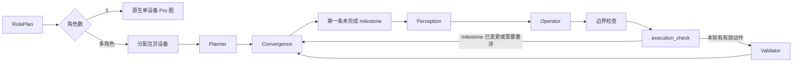

# 低侵入 Pro 角色运行时

本说明记录当前实现边界，以 `351ca84` 为原生 Artemis 基线。普通单角色 Pro 经 RolePlan 判定后调用原有 `run_automation` 和原生 Pro 图；Flash 不进入角色运行时。只有多角色用例进入 `MultiDeviceAgent`。现有 CLI、Home / Workspace 和 daemon worker 可以提交 Pro 任务；SDK 也可明确调用 `MultiDeviceAgent.run_case`。外层只规划一次 RolePlan，并将结果传给多设备 runner。

## 保留的扩展

| 文件 | 责任 |
| --- | --- |
| `artemis/agents/role_planner/`、`runtime/multi_device/models.py`、`allocation.py` | 在设备分配前确定固定角色，并校验显式绑定与准备需求。 |
| `runtime/multi_device/dispatch.py` | 在现有 Pro 入口选择原生单设备路径或多设备 runner；不重复生成 RolePlan。 |
| `runtime/multi_device/graph.py`、`runtime.py` | 复用 Pro 节点，按 Markdown 第一条未完成 milestone 路由；A → B → A 和同角色下一 milestone 均重新 Perception。 |
| `runtime/multi_device/data_engine.py` | `DataEngine` 子类为角色步骤、trace、历史和事件附加归属；存储仍调用父类实现。 |
| `runtime/multi_device/check_policy.py` | 检查身份、退役、结果汇总、原设备检查和终审观察。原 Checker/checkpoint 流水线仍负责排队、执行、入账、修复和终态。 |
| `runtime/multi_device/leases.py`、`io.py` | 整组设备租约和进程内结果文件写入。 |

`graph.py` 的 `build_pro_graph` 接受外层路由扩展，原 `get_graph(ctx)` 保留原生接线。Planner 接受已确定的 RolePlan 并生成原格式、带 `[role:ID]` 的顶层 Markdown milestone。Validator 执行标准动作协议。Operator 有一个本轮输入准备接点，由外层注入角色提示和带设备权限的工具；内部只处理中途 milestone 改变时的动作中止和 ToolMessage 配对。路由与设备权限规则在外层。

核心无法完全零改动。`graph.py` 需要一个图装配接点、计划所有者与本轮 milestone 的证据归属；`checkpoints.py` 需要可选策略以区分同文案但不同角色的检查、在原设备执行 checkpoint、正确退役和统计；`checker.py` 需要带身份的 verdict 归一化及各设备终审观察；`notes.py` 需要一个原子计划提交接点来统一校验和检测内容冲突。这些扩展在普通上下文未设置时沿用原生行为。`DataEngine` 原类保持基线，角色特性放在子类；子类通过 `super()` 复用存储和异步清理。

## 收敛量化

统一以 `351ca84` 为基线，收敛前取 `baa9944`，收敛后取本次提交。统计生产代码，不含测试、文档及工作区独立的 provider/config 修改；保留的通用正确性修复仍计入。

| 指标 | 收敛前 | 收敛后 |
| --- | ---: | ---: |
| 修改的既有生产文件 | 30 | 22 |
| 既有文件新增 / 删除行 | +825 / -167 | +562 / -160 |
| 新增生产文件 | 14 | 14 |
| 新增文件代码行 | 1878 | 1957 |

既有文件的改动行数减少约 27%。扩展模块代码有所增加，主要承接从原生类和节点中移出的职责；不能把这部分搬迁当成总体复杂度消失。原生 DataEngine 与基线一致；Checker 差异从 +54/-3 收敛为 +21/-5，checkpoint 从 +172/-42 收敛为 +83/-34，graph 从 +124/-30 收敛为 +106/-33。Operator 保留两个必要接点，没有继续扩大其职责。

动作会话的取消排空和 ADB 子进程终止在租约释放前完成，避免上一运行的动作落在下一运行的设备上。异步日志和工具 trace 使用任务局部执行范围，避免并发角色串写证据。这些是通用资源正确性修复，不实现角色业务策略。原有 Checker 开关照常生效。

## 撤除的外围入口

本轮撤除独立 `/api/cases`、`mobile_*_case` MCP 工具、远程 client Case API、`run-case` CLI、后台 `jobs.py` 作业框架和独立 `/cases` 页面/导航。运行仍由现有 Pro 入口或明确的 SDK API 发起。旧 Case 设计文档和 UI 原型是历史方案，不代表当前可调用接口。

账号登录、业务 feature 开关、KB、CaseAdapter 和 PlanReviewer 具体规则不在此运行时内；没有为它们保留空图节点。设备及账号 fixture 由调用方准备。多设备图只支持单主机直接寻址的 Android 设备，真机端到端验收仍需要实际 App 和设备。
