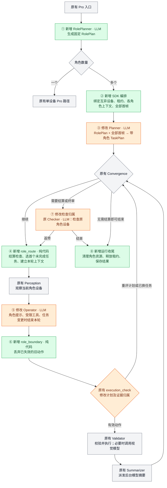

# Artemis 多设备最小改造说明

**核心方案：先用 RolePlan 确定固定参与者及设备，再让原 Planner 生成带角色的 TaskPlan；执行时复用原 Pro 图，按第一条未完成 milestone 选择角色。**

本文对应多设备代码 `788bc0f`，原生基线为 `351ca84`。只说明当前实现；KB、CaseAdapter、PlanReviewer 业务规则尚未接入。图中 **绿色＝新增，橙色＝修改，灰色＝原有**；`LLM` 表示涉及模型调用。

## 1. 整体改造图

**贯穿图的两项支撑改造：**TaskPlan 写入统一经过代码校验；动作、日志和检查带上 role / milestone / turn 归属。它们不是新增模型节点。主动作按 milestone 顺序执行，后台检查和摘要仍可异步运行。

普通入口只规划一次 RolePlan，多角色时直接传给 SDK；单角色也先做这次角色判断，再返回原生路径。显式调用 `MultiDeviceAgent.run_case` 时使用该 SDK 路径；已传 RolePlan 就不再规划。Flash 和 Cloud 不进入上述本地多设备分派。

## 2. RolePlan 是什么，给谁使用

RolePlan 只描述“有哪些固定参与者”：`roles` 中有角色 ID、用例身份、描述、feature 需求，另有 `assumptions` 和 `unresolved`。**它不包含 milestone，也不保存设备截图。**角色到设备的映射另存于 `role_bindings`；`account_ref` 是外部账号引用，当前不自动登录。

例如“A 发消息 → B 回复 → A 确认”，RolePlan 始终只有 A、B 两个角色；TaskPlan 则有三条依次绑定 A、B、A 的 milestone。

| 使用方 | 如何使用 RolePlan |
| --- | --- |
| `dispatch.py` | 按角色数量选择原生单设备路径或多设备 SDK。 |
| `allocation.py`、准备校验 | 为每个角色分配不同设备，校验已准备的 feature；设备不足不合并角色。 |
| `MultiDeviceAgent` | 校验计划与绑定，为每个角色建立上下文，采集首帧；保存运行清单。 |
| Planner | 把完整 RolePlan 放进提示词，让模型给顶层 milestone 标注 `[role:ID]`。 |
| Operator | 每轮收到完整角色约束、当前角色和当前 milestone；只操作本轮设备。 |
| `RoleBindingValidator` / runtime | 读取合法角色集合，拒绝未知角色、越权完成与跳步。实际调度读 TaskPlan。 |
| Checker / trace | **间接使用** TaskPlan 的角色标签、上下文和执行范围，不重新生成或解释完整 RolePlan。 |

RolePlan 在整个多设备运行中保持固定；可更新的是 TaskPlan。普通单角色入口回到原生图后，不继续注入这套多角色约束。

## 3. 哪些属于角色上下文，为什么每轮都走 role_route

上下文分为三层，不能理解成“每个角色保存一整份图状态，再来回恢复”。

| 层级 | 包含什么 | 切换时怎么处理 |
| --- | --- | --- |
| **全运行共享** | RolePlan、TaskPlan、普通笔记、DataEngine、检查台账、设备绑定 | 持续保留；共享业务事实。 |
| **角色长期上下文** | `contexts[role_id]`：设备 / driver、ADB / MCP / ActionSession、角色节点实例、Operator 对话及归档、角色历史视图 | 选择对应角色实例；A → B → A 时 A 的对话历史还在。 |
| **当前轮次状态** | 图 `State` 的截图、UI、坐标索引、待执行动作、反馈、incident；以及 `ExecutionScope` 的 role / milestone / turn / step / phase | 每轮建立新执行范围；角色或 milestone 变化时清理旧任务状态，再经 Perception 获取新观察。 |

**`role_route` 实际承担“本轮任务选择与准备”，名字中的 role 不代表只有换设备才运行。**每轮都要读取最新 TaskPlan、结算待检查项、选第一条未完成 milestone、建立新的 `turn_id`，然后交给当前角色的 Perception。全过程不调用模型，也不重新分配设备。

- **A → B：**切换角色实例，停止旧后台 ADB，归档待提交对话，清除旧截图、坐标、动作和任务反馈。
- **A 的任务 1 → A 的任务 2：**设备与角色实例相同，但旧任务的动作、incident 和完成反馈不能沿用；同样需要清理并重新观察。
- **仍是 A 的任务 1：**保留该任务的执行反馈和 incident，进入下一轮 Perception；不做整套任务切换清理。

例如 A 的任务 1 是“输入目的地”，任务 2 是“点击路线”。任务 1 完成后页面可能已经变化；如果直接沿用旧坐标、旧动作或旧完成判断执行任务 2，就可能跳步或点错。因此同角色换 milestone 也必须经过这一入口。终审返修会保留专门的修复反馈。

## 4. Planner / Operator 具体改了什么

### ③ Planner：仍负责生成一份 TaskPlan

1. **输入增加角色约束。**在原 system prompt 后追加 `runtime.planning_instructions()`，含完整 RolePlan 和 App / 环境说明；要求每个顶层任务以 `[role:ID]` 开头，跨角色任务在规划时拆开。
2. **输入增加全部设备首帧。**由 SDK 事先采集，逐张标明角色后交给 Planner，不只看第一台设备。
3. **校验增加角色规则。**在已有计划格式校验 / 重试中加入 `runtime.policy.validate()`；仍不合法就结束运行，退出 Planner 时外层再校验一次。

Planner 正常只在图入口运行，内部可能有多次模型与工具调用。后续由 Operator 更新计划；没有为每次角色切换重新跑 Planner。

### ⑤ Operator：增加两个内部接点

1. **模型循环前：**`prepare_operator_turn()` 加一条角色 SystemMessage，并把工具包装为受当前执行范围约束的工具；同时调整对话归档边界。角色提示与权限规则都在外层 runtime。
2. **工具处理后：**若计划更新使当前 milestone 改变，取消同一回复中的旧动作、补齐对应 ToolMessage，然后结束本次 Operator 调用。

例：一次回复同时包含“完成任务 1”和“点击某坐标”。完成后已切到任务 2，点击必须取消，但其 `tool_call_id` 仍需得到一条“未执行”的工具结果，才能维持对话协议完整。**补齐结果不等于执行动作，也不表示成功。**

### ⑥ Operator 返回后：再做一次代码边界检查

`role_boundary` 清除失效动作，`execution_check` 回到计划评估；有效标准动作仍交给原 Validator。动作入队和派发时也检查执行范围，防止旧异步任务迟到后继续操作设备。

这两个内部接点与外层节点是当前必要侵入；原 Operator 的决策循环和动作翻译主体保留。外层节点只能在 Operator 返回后运行，不能中断其内部长时间分析旧截图。

## 5. 哪些会调用模型，提示词在哪里改

### 模型调用

下表列的是调用位置和配置名，**不是固定模型型号，也不是每轮都会执行的清单**；实际 provider / 型号由配置决定。本次新增加的规划阶段只有 RolePlanner。

| 位置 | 何时调用模型 | 本次变化 |
| --- | --- | --- |
| **RolePlanner** | 启动时识别角色，复用 `planner` 配置与 fallback | **新增阶段**。通常一次成功；格式 / 契约错误允许一次纠正，fallback 也可能增加请求次数。 |
| **Planner** | 开始生成 TaskPlan，可能在内部多轮调用 | 原有；增加角色约束和多设备首帧。 |
| **Operator** | 每轮决策，可在一次节点调用中多轮使用工具 | 原有；增加本轮角色提示。 |
| Planner Validation | 顶层计划变化触发且开关启用；配置名 `planner_validation` | 原有建议性审查；不是 RoleBindingValidator，不自动回滚计划。 |
| Explorer / Diagnoser | Operator 调用定位 / 诊断工具时；配置名 `explorer` / `diagnoser` | 原有按需调用，使用当前角色上下文。 |
| Validator 的视觉检查 | 原有动作前置校验需要像素判断时；`validator_pixel_safety_net`，兼容回退 `validator` | 原有；不能把整个 Validator 当成纯代码。 |
| Checker | 按配置执行 checkpoint / 最终检查；配置名 `checker` | 原有；增加检查身份、角色证据和终审多设备观察。 |
| Summarizer / 记忆摘要 | 后台生成步骤视觉摘要、按条件生成历史分块摘要 | 原有；图中 Summarizer 派发后台任务，并非每次同步等待模型。 |
| Outputter | 启用且有输出要求或强制综合时 | 原有可选结果生成。 |

**不新增 LLM 调用的部分：**角色分配、租约、`role_route`、`role_boundary`、RoleBindingValidator、TaskPlan 内容冲突检查、trace 归属和清理。Perception 主路径是截图 / UI 树及可选 OCR，不经过对话 LLM；Explorer 内部的视觉检测、图像处理等仍按原工具配置调用相应服务。

### 提示词与模型输入改动

**没有修改原 Planner / Operator 的提示词模板文件；主要是在 Python 中追加输入。**

| 位置 | 新增 / 修改内容 |
| --- | --- |
| `agents/role_planner/__init__.py` | **新增 RolePlanner system prompt**：识别固定参与者，不合并以迁就设备数量、不生成 milestone、不操作设备；账号映射不明确就报告 `unresolved`。HumanMessage 包含用例、绑定身份、App 信息与 feature 目录；契约错误时追加纠正提示。 |
| `multi_device/plan_policy.py::role_instructions()` | **新增共用角色约束**：完整 RolePlan、顶层角色标签、子任务继承、保留顶层身份与顺序、跨角色任务展开、换任务后等待新观察。供 Planner 与 Operator 使用。 |
| `multi_device/runtime.py` | `planning_instructions()` 追加 App / 环境说明；`operator_instructions()` 再追加当前角色、milestone 文本 / hash、只能执行本任务、不可共用别的设备坐标、跨设备事实关联 token。 |
| `agents/planner/planner.py` | 在原提示词后拼接上述说明；HumanMessage 加各角色首帧及标签。 |
| `agents/checker/checker.py` | **修改模型输入和输出 schema**：历史 / 检查项带角色与 `check_key`，要求返回对应检查身份；终审提供带标签的全部设备观察。不是新增独立 Reviewer 提示词。 |
| `agents/operator/operator.py` | 任务变化时追加“未执行，等待新观察”的 ToolMessage，向后续模型如实说明被取消动作。 |

## 6. 其他改造分别解决什么

| 改造 | 实现与效果 |
| --- | --- |
| **① 先角色后设备** | 角色按用例身份确定，设备数不足提前失败；不因某人“发送 / 接收”身份变化而生成新角色。 |
| **② 复用原入口和节点** | CLI / 原任务队列延迟设备选择；SDK 为各角色创建上下文，`build_pro_graph` 提供可选扩展；多设备图只新增两个节点。 |
| **④ 确定性顺序约束** | 从共享 TaskPlan 取第一条未完成顶层任务；`[!]` 阻塞时不跳过。Operator 只能完成当前任务，不能删改既有顶层身份 / 顺序；可添子任务或末尾追加任务。 |
| **统一计划写入** | `notes.py → runtime.commit_plan()`：进程内锁、比较提交前内容、角色 / 顺序校验、临时文件替换。冲突或非法更新返回错误，保留原计划。`plan_revision` 只是诊断计数，不是数据库版本事务。 |
| **⑦ 检查归属** | 原 Checker 流水线接收 `RoleCheckPolicy`，同文案检查按身份区分，在原角色设备验证；verify 失败可重开原任务，终审看全部设备。原有检查开关继续生效。 |
| **证据与权限归属** | `ExecutionScope` 标记产生动作 / 日志时的角色、任务和轮次；`RoleDataEngine` 子类复用原存储。迟到日志保留原归属，旧轮次失去设备操作权限。 |
| **⑧ 租约与清理** | 整组设备全部取得才执行；部分取得失败则释放后重试。结束 / 取消时先清理设备动作、后台 ADB 和录像，再释放租约；随后收尾 trace 与结果文件。 |

原 DataEngine 类和标准动作协议保留。早期独立 Case API、Case MCP、`run-case`、后台 jobs、独立 cases 页面已撤除；历史原型文档保留。当前只支持同一主机直接寻址的 Android 设备，账号准备由调用方完成。

## 7. 新增文件速查

以下列全 **14 个新增生产文件**；表内 `multi_device/` 统一指 `artemis/runtime/multi_device/`。

| 文件 | 一句话说明 |
| --- | --- |
| `artemis/agents/role_planner/__init__.py` | 调用模型生成 RolePlan，并校验角色绑定、feature 需求及必要的一次纠正。 |
| `artemis/runtime/execution_scope.py` | 用 ContextVar 保存当前执行归属，让工具、动作和异步日志取得正确角色与 step。 |
| `multi_device/__init__.py` | 包入口，无业务调度逻辑。 |
| `multi_device/models.py` | 定义 RolePlan、RoleSpec、设备绑定、App 信息和运行请求。 |
| `multi_device/dispatch.py` | 普通 Pro 入口先规划角色，单角色返回原路，多角色把计划传给 SDK。 |
| `multi_device/allocation.py` | 为角色选择互异在线设备，考虑首选设备，拒绝数量不足。 |
| `multi_device/leases.py` | 复用设备锁，实现整组取得 / 全部释放、等待及取消清理。 |
| `multi_device/graph.py` | 把 `role_route`、`role_boundary` 接入原 Pro 图，并为各角色构建原节点实例。 |
| `multi_device/runtime.py` | 运行时主体：选任务、切上下文、包装节点 / 工具、提交计划、组织返修和进度。 |
| `multi_device/plan_policy.py` | 共用角色提示词与确定性 TaskPlan 规则：角色标签、首个未完成任务、写入权限。 |
| `multi_device/check_policy.py` | 检查身份、角色归属、结果归一化、检查退役和汇总，接回原 Checker 流水线。 |
| `multi_device/data_engine.py` | 原 DataEngine 的轻量子类：附加执行归属、保留异步上下文、过滤角色历史。 |
| `multi_device/io.py` | 写运行进度 / 结果 JSON 的小工具。 |
| `artemis/sdk/multi_device_agent.py` | 总编排入口：接收 / 生成 RolePlan、设备准备、首帧、运行图、结果判定与清理。 |

读代码建议从 **`dispatch → multi_device_agent → graph → runtime`** 开始，再按需要看 `plan_policy` 和 `check_policy`。命令及 SDK 示例见 [多设备使用方式](multi-device-usage.md)。

**当前边界：**角色约束不证明业务完成声明正确；输入误报、暂态截图长期复用、Windows 计划替换失败仍是待修复项。本文未将这些修复、KB、CaseAdapter 或 PlanReviewer 当作已实现能力。
