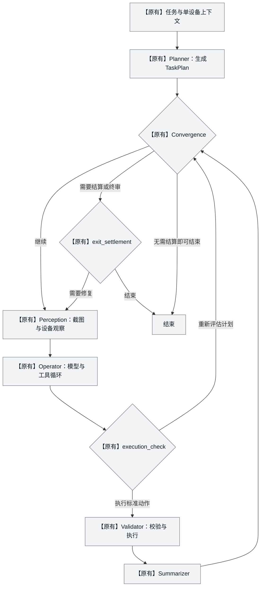
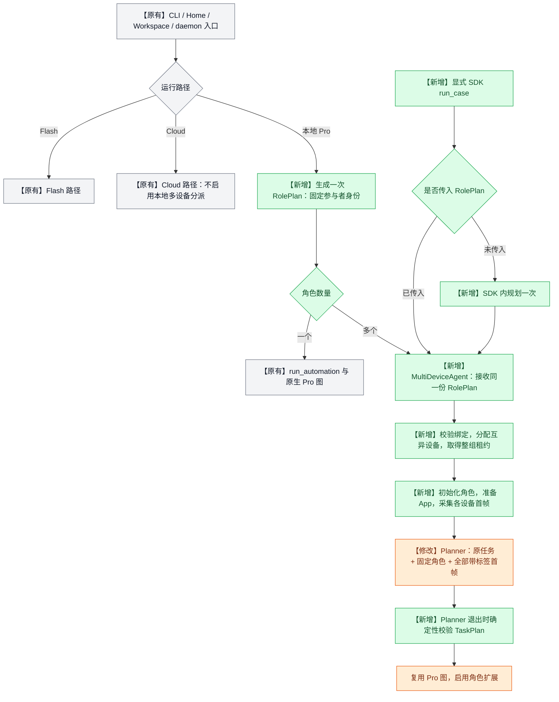
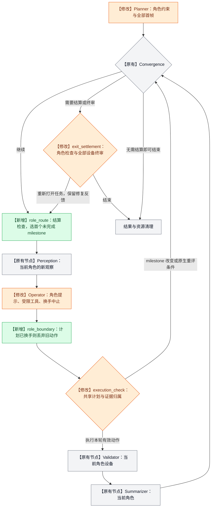
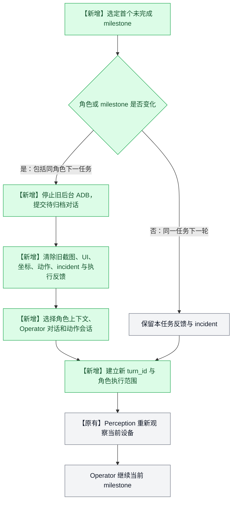
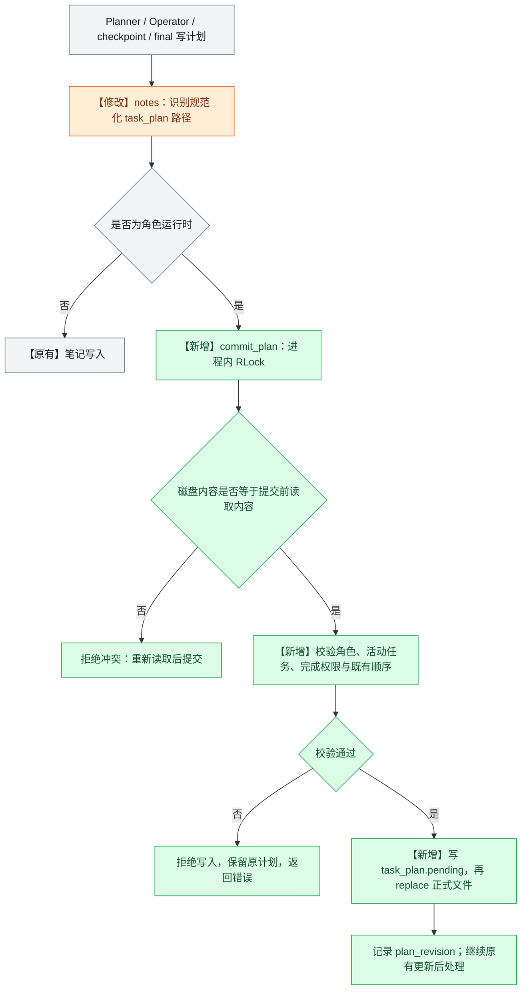
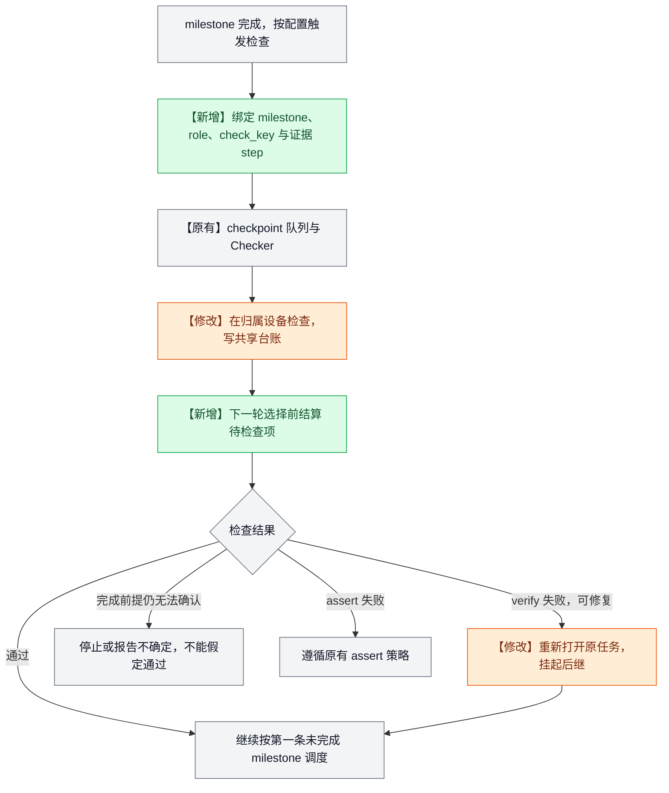
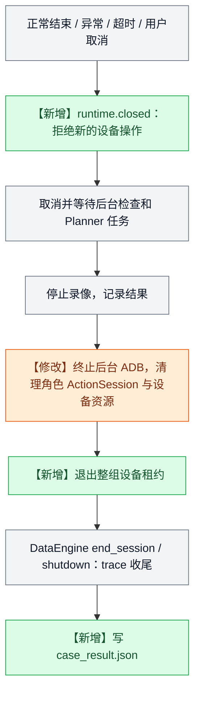
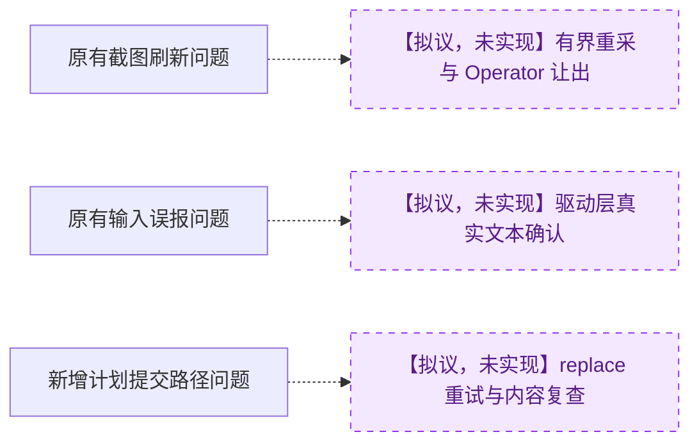

# Artemis 多设备优化方案：低侵入实现与改动全图

> **方案：固定 RolePlan，复用原有 Pro 图，在图装配、轮次边界、计划写入和检查归属处增加必要接点。**
>
> 本文区分已落地实现与未实施建议。测试不进入生产路径；删除测试不会减少生产架构的侵入性。建议收敛重复测试，保留关键行为覆盖。

更新日期：2026-10-20。原生对比基线为本地 `351ca84`，多设备生产代码为 `788bc0f`。“原有”均指该基线，不代表已同步官方仓库最新版本。工作区独立的 Codex provider、模型配置等修改不计入多设备提交。本文不讨论 YAML，不实现 KB、CaseAdapter 和 PlanReviewer 的业务规则。

## 1. 改动标记

| 标记 | 含义 |
| --- | --- |
| **【原有】** | 复用 Artemis 基线能力；图中灰色。 |
| **【新增】** | 新的外层运行时、数据结构或路由节点；图中绿色。 |
| **【修改】** | 既有生产文件增加接点或修正行为；图中橙色。 |
| **【撤除】** | 早期方案曾加入、当前生产代码已移除的内容。 |
| **【拟议，未实现】** | 后续建议，不作为当前能力验收；图中紫色虚线。 |

颜色只辅助阅读，文字标记是判断依据。流程图没有加入尚未存在的 CaseAdapter / PlanReviewer 节点。

## 2. 原有 Artemis Pro 流程

原有 Planner 是图的入口节点，正常执行中不在每轮重新运行。后续 Operator 可以更新共享 TaskPlan，Checker 的失败修复也可能重新打开任务。



Planner Validation 是已有的计划建议机制，异步结果由执行检查消费，反馈给 Operator 决定如何修订。它不等于确定性的角色约束，也不保证自动返回一份正确的新计划。

**必须区分两个循环：**外层图每次经过 Perception 才获得新观察；一次 Operator 调用内部还会反复调用模型和工具。内部调用 Explorer 并不等于重新走了一次 Perception。这是暂态画面长时间被重复分析的关键背景。

## 3. 总体入口：RolePlan 在设备分配之前生成



- **RolePlan 固定参与者，不生成执行 milestone。**A 发消息、B 回复、A 确认，是两个角色，不是三个；设备不足应报错，不能把两个角色压缩到同一设备。
- **TaskPlan 仍由原 Planner 生成并在执行中更新。**顶层 milestone 加 `[role:a]` 标签，子任务继承父级角色。
- 外层已经规划的 RolePlan 传给 SDK，不重复规划。普通入口的单角色回到原生 Pro；显式调用 `MultiDeviceAgent.run_case` 时，即使只有一个角色，也使用该 SDK 的运行时。
- 多设备 Planner 需要各设备的初始状态，当前 runner 已在进入图之前采集全部角色首帧。RolePlan 自身不依赖截图。首帧不保证页面稳定，也不保证之后账号或页面没有变化。
- `account_ref` 是外部账号引用；当前不自动登录。调用方先准备账号与业务 feature。App 准备复用安装、启动能力，不能等同于完成账号准备。

## 4. 已落地多设备图：新增节点只有两个

**图上的新增节点为 `role_route` 和 `role_boundary`。**原节点由外层 wrapper 选择正确角色上下文并建立执行范围，不复制一整套 Pro 图。



原有 Checker、checkpoint、终审开关继续生效。“结算检查”不是强制启用所有检查，而是处理实际已配置、已排队的检查。

### 4.1 如何保证第一条未完成 milestone

调度依据是共享 `notes/task_plan.md` 的书面顺序，不是 Operator 自报角色，也不是把同一角色的任务批量执行。

```markdown
- [x] [role:a] 发出消息
- [/] [role:b] 回复消息
- [ ] [role:a] 确认回复
```

`RoleBindingValidator.target()` 顺序扫描顶层，跳过已完成项，返回第一个未完成项及其角色。若该项为阻塞状态 `[!]`，停止并要求修复，不能跳过去执行下一条。

**【新增】写入校验与调度共同约束：**最多一个顶层任务拥有活动状态，且必须是第一条未完成任务；Operator 本轮只能完成当前 milestone，不能提前完成同角色的下一条，也不能完成其他角色的任务。原有顶层身份与顺序必须保留；允许增加子任务或在末尾追加 milestone。当前身份依赖完整顶层文本，因此执行中改名也会被拒绝。

这保证结构和顺序，不能证明业务动作充分、截图稳定或完成声明属实。完成声明仍需要配置相应 Checker 验证。

### 4.2 上下文切换：A → B → A 与 A → A



每个角色保留自己的 Operator 对话历史，但回到 A 时不会恢复 A 之前 milestone 的旧截图、坐标或 incident。共享笔记传递业务事实，不共享另一台设备的坐标。终审要求返修时，专门保留对应修复反馈。

### 4.3 Operator 侵入性：必要接点与外层职责

| 位置 | 当前改动 | 必要原因 |
| --- | --- | --- |
| 进入模型循环前 | **【修改】**调用 `prepare_operator_turn`，注入角色提示及受限工具 | 本轮设备权限由外层 runtime 管理。 |
| 内部工具处理后 | **【修改】**milestone 改变则结束本轮，并补齐被取消动作的 ToolMessage | 同一回复可能既更新计划又提交旧动作；仅在返回后检查不足以维护工具对话。 |
| 返回后 | **【新增】**`role_boundary` 再检查，清除失效动作 | 防止跨轮动作进入 Validator。 |
| 工具 / ActionSession | **【修改】**工具调用、动作入队及实际派发检查执行范围 | 迟到的旧异步任务不能操作当前设备。 |

例：模型一次回复发出 `update_note(call_1)` 和 `tap(call_2)`；前者完成当前 milestone 后，后者应取消。对话中仍需给 `call_2` 一条带相同调用 ID 的取消结果，否则下一次请求会出现 ToolCall / ToolMessage 不配对。**配对修复不执行取消的动作，也不把取消记为成功。**

这是受限的核心接入，不是零侵入。标准动作的翻译、校验、执行仍使用原 Validator。外围 `role_boundary` 只能在 Operator 返回后生效，无法单独解决其内部长期分析旧截图的问题。

## 5. TaskPlan 集中写入：位置、校验与失败处理

**【修改】入口在 `artemis/utils/notes.py`；【新增】提交在 `MultiDeviceRuntime.commit_plan()`；规则在 `plan_policy.py`。**TaskPlan 别名先规范化，再进入同一写入路径。普通笔记继续走原逻辑。Operator 原有计划更新拦截仍触发后续验证；集中提交补充底层一致性约束。



这里是**内容比较式冲突检查**，不是数据库版本事务。`plan_revision` 是诊断计数，不是调用方提交的版本令牌；锁只覆盖当前进程，不能宣称支持多个进程并发编辑同一计划。

- Operator 写入失败：返回工具错误，保留原计划，由既有错误处理让模型重新读取、修订，不能悄悄执行同一回复中的旧动作。
- Planner 写入失败：可在自身工具循环内修订；退出时仍检查最终计划。最终不合法则抛错结束运行，不能进入执行。
- checkpoint / final 为系统修复阶段，可重新打开已完成任务；Operator 无权自行重新打开或删除已完成 milestone。
- 这些校验不修复业务语义，不实现“自动返回正确 TaskPlan”的 PlanReviewer。

**【已知缺陷】**Windows 曾出现 `.pending → .md` 的 `PermissionError`；当前没有定向重试。具体原因与建议见第 10 节，不能把原子替换描述为不会失败的写入。

## 6. 检查、证据与结果归属

原 Checker 流水线继续负责排队、执行、入账与修复。**【新增】`RoleCheckPolicy` 提供角色策略；【修改】Checker 与 checkpoint 接受该策略。**



相同“消息已发送”文案可能属于不同角色，不能互相冒充通过；使用角色 / 父任务关联的检查身份，含糊报告按无法确认处理。换手前等待实际待结算检查，超时取消并记录未检查；若仍完成着的 milestone 的必要 verify 无法确认，阻止继续。verify 正常失败会先重新打开原任务，再回原角色。

终审采集各设备带角色标签的观察，避免只检查最后一台设备。终审返修先映射、重新打开对应 milestone，再走 `role_route`。结果区分 `completed`、`failed`、`inconclusive`、`cancelled`；全部打勾不自动等于成功，失败、未检查或启用的终审未通过都影响结果。关闭的检查不会被这套机制凭空补上。

### 数据与权限边界

| 对象 | 所有者与生命周期 | 当前约束 |
| --- | --- | --- |
| RolePlan | 整次运行固定 | 参与者身份与设备绑定不由 Operator 动态改写。 |
| TaskPlan | 整次运行共享，受限更新 | Markdown 为唯一调度依据，没有另一份独立执行计划。 |
| 设备上下文、Operator 对话、UI 索引、ActionSession | 各角色独立 | 选择对应实例，不能复用其他设备坐标。 |
| 普通笔记 | 共享 | 保存业务事实和关联标识，不自动证明事实正确。 |
| ExecutionScope | 任务局部 ContextVar | role / device / milestone / turn / step / phase；过期轮次无设备操作权限。 |
| DataEngine | 全运行共享存储 | **原类与基线一致**；新增 `RoleDataEngine` 子类经 `super()` 复用存储，附加归属与历史过滤。 |
| 异步日志和工具 trace | 保留产生时的执行范围 | 迟到日志仍归原角色 / step，不取写出时的全局当前角色。 |

## 7. 取消、异常与租约释放

**【新增 / 修改】设备侧清理发生在整组租约释放前。**避免旧运行尚能发动作时，设备已被下一运行取得。



清理任务被 shield，重复取消也等待它结束。共享 engine 的 trace 收尾发生在退出租约之后。清理步骤有时间界限，并记录错误，不能保证操作系统或设备故障时所有清理动作都成功。

会话 trace 目录包括 `multi_device.json`、`case_progress.json`、`case_result.json`、标准步骤与 Checker 台账。结果应结合 `cleanup_errors`、终审状态和检查台账阅读。

## 8. 生产代码清单：保留与撤除

### 8.1 【修改】22 个既有生产文件

行数以 `git diff 351ca84 788bc0f --numstat` 为准，排除测试、文档及未提交的 provider / config 工作。

| 既有文件 | 新增 / 删除行 | 保留的改动与理由 |
| --- | ---: | --- |
| `apps/admin_console/routers/tasks.py` | +7 / -1 | Pro 延迟设备选择，复用原任务队列。 |
| `apps/admin_console/services/task_queue_service.py` | +1 / -1 | 配合 Pro 外层分派。 |
| `apps/admin_console/server.py` | +15 / -2 | 通用 JS MIME 修复，不属于角色调度。 |
| `artemis/agents/planner/planner.py` | +24 / -2 | 角色约束和各设备首帧输入。 |
| `artemis/agents/operator/operator.py` | +29 / -2 | 输入准备、换手中止、工具消息配对。 |
| `artemis/agents/checker/checker.py` | +21 / -5 | 带身份的检查结果与多设备终审观察。 |
| `artemis/context.py` | +8 / -1 | 可选 runtime、角色、计划所有者与检查策略引用。 |
| `artemis/graph/graph.py` | +106 / -33 | 节点装配、可选图扩展、共享计划与证据归属。 |
| `artemis/graph/checkpoints.py` | +83 / -34 | 可选检查策略、身份与失败修复。 |
| `artemis/graph/perception.py` | +1 / -1 | 读取共享计划所有者；截图刷新算法未改变。 |
| `artemis/interfaces/cli/commands/run.py` | +26 / -3 | 原入口增加一次 RolePlan 分派。 |
| `artemis/sdk/__init__.py` | +17 / -1 | 导出多设备 SDK 与模型。 |
| `artemis/sdk/agent.py` | +5 / -8 | 通用 Android 当前用户锁屏判断修复。 |
| `artemis/runtime/device_lock.py` | +3 / -0 | 支持整组设备租约协作。 |
| `artemis/mcp/action_session.py` | +44 / -6 | 执行范围检查、取消与排空。 |
| `artemis/drivers/android/adb_driver.py` | +101 / -26 | 可取消 ADB 子进程与执行范围接入；未修复中文输入策略。 |
| `artemis/mcp/actuators/adb.py` | +2 / -2 | 通用输入反馈隐私调整，不构成输入结果校验。 |
| `artemis/services/llm.py` | +5 / -0 | 从当前执行范围取得 engine。 |
| `artemis/tools/tool_wrapper.py` | +3 / -1 | 工具 trace 使用任务局部 engine。 |
| `artemis/utils/notes.py` | +19 / -9 | TaskPlan 集中提交与路径规范化。 |
| `artemis/utils/plan_grammar.py` | +8 / -0 | 检查项身份支持。 |
| `third_party/mobile_use/utils/logger.py` | +34 / -22 | 异步日志保留产生时的 engine 与 step。 |

MIME、锁屏判断、输入反馈隐私是保留的通用修复，并非角色架构必须依赖的业务逻辑；不能把所有差异都解释成必要的角色接点。

### 8.2 【新增】14 个生产文件

| 文件 | 行数 | 职责 |
| --- | ---: | --- |
| `artemis/agents/role_planner/__init__.py` | 172 | 一次性角色规划与输出约束。 |
| `artemis/runtime/execution_scope.py` | 59 | ContextVar 执行范围。 |
| `artemis/runtime/multi_device/__init__.py` | 1 | 包入口。 |
| `artemis/runtime/multi_device/models.py` | 74 | 角色、绑定与请求数据结构。 |
| `artemis/runtime/multi_device/allocation.py` | 17 | 互异设备分配。 |
| `artemis/runtime/multi_device/dispatch.py` | 37 | 单角色 / 多角色分派，复用已生成计划。 |
| `artemis/runtime/multi_device/graph.py` | 31 | 两个新增节点与原图接线。 |
| `artemis/runtime/multi_device/plan_policy.py` | 142 | 确定性角色、顺序与修改权限。 |
| `artemis/runtime/multi_device/runtime.py` | 556 | 轮次、上下文、计划提交与节点包装。 |
| `artemis/runtime/multi_device/check_policy.py` | 186 | 检查归属、退役、汇总与原设备检查。 |
| `artemis/runtime/multi_device/data_engine.py` | 67 | 角色 DataEngine 子类。 |
| `artemis/runtime/multi_device/leases.py` | 124 | 整组设备租约。 |
| `artemis/runtime/multi_device/io.py` | 12 | 运行结果 JSON 写入。 |
| `artemis/sdk/multi_device_agent.py` | 479 | SDK 编排、设备准备、执行与清理。 |

### 8.3 相对早期 Braden 改动的收敛

| 内容 | 当前处理 |
| --- | --- |
| RolePlan、固定角色、设备绑定、A → B → A | **保留**，放在外层 runtime。 |
| 角色证据、原设备检查、失败回原任务 | **保留并收敛**，原检查流水线加可选策略。 |
| 租约、取消排空、异步 trace 归属 | **保留**，防止资源或证据串用。 |
| 原生 DataEngine 内的大范围角色逻辑 | **撤出原类**，新增子类承接。 |
| 原图中的角色调度职责 | **向外收敛**，原图提供装配接点，扩展提供路由。 |
| 独立 `/api/cases`、`mobile_*_case` MCP、远程 Case client API | **【撤除】**，不维护第二套运行入口。 |
| `run-case` CLI、后台 `jobs.py`、独立 `/cases` 页面和导航 | **【撤除】**，用现有 Pro 入口或显式 SDK。 |
| 实验性计算器业务硬编码 | **【撤除】**。 |
| 历史设计文档与 UI 原型 | **保留原文件**，不代表当前 API。 |

统一比较基线 `351ca84`；收敛前取 `baa9944`，当前取 `788bc0f`：

| 指标 | 收敛前 | 当前 |
| --- | ---: | ---: |
| 修改的既有生产文件 | 30 | 22 |
| 既有文件新增 / 删除行 | +825 / -167 | +562 / -160 |
| 新增生产文件 | 14 | 14 |
| 新增文件总行数 | 1878 | 1957 |

既有文件改动行数由 992 减为 722，减少约 **27%**。新增模块增加 79 行，承担移出的职责；搬迁不等于复杂度消失。当前仍修改 22 个既有生产文件，不能称为无侵入。进一步收敛应围绕必要接点与职责边界，而不是删除测试来减少 diff。

## 9. CaseAdapter、KB 与 PlanReviewer 的边界

**具体业务实现均未落地；当前不增加空节点。**

| 能力 | 当前方案位置或边界 |
| --- | --- |
| 固定参与者身份 | RolePlan，在设备分配之前确定。 |
| milestone 绑定角色 | Planner 依据固定 RolePlan 写入，确定性规则拒绝非法绑定。 |
| 场景 KB 匹配 | 后续 CaseAdapter 职责，不在本文实现。 |
| CaseAdapter 审查初始 TaskPlan | 可在 Planner 后、Convergence 前接入，不必放入 Perception。当前只有角色结构校验，不是完整 CaseAdapter。 |
| 账号需求与准备 | 当前由调用方准备，`account_ref` 仅引用。未来若 CaseAdapter 改变账号或登录状态，应重采相关设备观察并确认计划前提。 |
| PlanReviewer 修复同事已知 TaskPlan Bug | 暂不推测规则。`role_boundary` 只防止失效动作执行，不承担通用计划纠错。 |

后续 Reviewer 修改 TaskPlan 应走同一提交路径，并声明其权限与失败策略；放在 Operator 后，只能审查实际收到的输出，不能声称覆盖 Operator 内部循环。系统级重写权限随具体 Bug 设计，不能直接绕开角色与顺序约束。

## 10. 已知问题：来源与最小修复建议

> **以下修复均为【拟议，未实现】。**记录问题不等于本轮已修复生产代码。

### 10.1 暂态截图被长期重复分析

运行 `09be833d-8151-4be8-8ba5-aacfef1fbc92` 中，点击搜索后确实采集了截图，但处于临时地图状态。Explorer 在同一次 Operator 调用内反复分析该帧，没有及时回 Perception。用户手动点击路线后出现的结果，不能记为系统自动点击成功。

**来源：原有机制。**与基线对比，Perception 等待与单次采集、Operator 内部工具循环、Explorer 读取 `latest_screenshot` 的机制均已存在。该停滞期间没有角色切换。独立 Codex provider / 高推理配置会放大耗时，不能据此把刷新问题归因于角色路由。

**最小建议：**明显加载 / 空观察时有界重采；同一截图连续定位失败时，Operator 补齐工具结果后结束当前调用，回原图重新 Perception。需极小的通用内部退出接点，仅增加 Operator 后的 Reviewer 无法打断内部循环。避免单按截图年龄拒绝所有动作，否则慢模型可能永远无法执行。

### 10.2 “无为市”输入失败却报告成功

同一运行中自动调用携带正确中文，之后截图输入框仍为空。设备日志显示 Helper 剪贴板访问被拒绝，写权限限制在前台；Helper 未建立可粘贴内容却返回成功，驱动派发粘贴键后也返回成功。

**来源：原有输入链路与成功判断。**基线已有 Helper 剪贴板写入、粘贴及派发成功返回逻辑；多设备提交未建立该策略。ADB 可取消改造不构成该次剪贴板拒绝的证据。用户手动输入不能计入自动成功。

**最小建议：**先在 `AndroidAdbDriver.input_text` 的 Helper 路径复用现有 `send_text` / `ACTION_SET_TEXT`，避开剪贴板；读取同一个聚焦、可编辑输入框，有界确认真实文本，保持清空 / 追加语义。无法确认则返回失败或不确定，不能把命令返回零直接当输入成功。其他 backend 返回契约不同，不能无条件替换。

本例 UI 树可观察聚焦框及其空文本，不必新增模型判断。`ACTION_SET_TEXT` 在目标 App 的兼容性仍需真机验证；当前未实施修复，也未修改设备剪贴板权限。

### 10.3 Windows 计划文件替换失败

该运行出现 `task_plan.pending → task_plan.md` 的 `[WinError 5] 拒绝访问`，之后重试成功。

**来源：错误发生于新增集中提交路径。**这是新增路径暴露的问题；具体文件占用者尚未确认，不能直接归因于某个 UI 读取进程。

**最小建议：**提交器对指定 Windows 访问 / 共享冲突短暂、有界重试，每次替换前重新检查预期内容，必要时用唯一临时文件；保留旧文件，如实报告最终失败。不能吞掉错误或关闭角色校验。



## 11. 新增的六个测试能否全部删除

**从生产依赖看，可以全部删除；从交付质量看，不建议。当前不删除测试。**生产代码不导入这些文件；删除减少的是测试和审查材料，不是生产执行步骤或核心耦合。

| 文件（均在 `tests/unit/runtime/`） | 行数 | 主要覆盖 |
| --- | ---: | --- |
| `test_minimal_role_runtime.py` | 205 | 同角色换任务、同任务反馈、回旧角色、初始计划拒绝、内容冲突、工具配对。 |
| `test_multi_device.py` | 513 | A → B → A、动作会话、旧 scope、trace、检查身份、写入别名与派发复查。 |
| `test_multi_device_lifecycle.py` | 424 | 预规划一次、无效输入提前失败、部分初始化、取消、租约与准备约束。 |
| `test_multi_device_ordering.py` | 170 | 首个未完成任务、禁止跳步 / 重排 / 删除 / 越权完成、同角色换任务。 |
| `test_multi_device_regressions.py` | 530 | 跨角色返修、检查身份、并发、录像取消、归档、终审错误与后台清理。 |
| `test_pro_role_allocation.py` | 260 | 先角色后设备、设备不足、单角色转发、多角色计划传递与原队列。 |
| **合计** | **2102** | 不计入第 8 节的生产代码统计。 |

**选择性删除还有测试依赖：**`ordering` 通过 `pytest_plugins` 复用 `test_multi_device`；`regressions` 复用 `test_multi_device` 与 `test_multi_device_lifecycle`。删 fixture 宿主前先迁移共享 fixture，否则剩余测试可能无法收集。全部六个一起删除没有这组内部依赖，但回归保护也全部消失。

### 建议如何收敛

可整理为“入口与分配、计划与路由、执行隔离与生命周期”三组，共享 fixture 放进 `conftest.py`，合并重复场景；不能承诺仅改文件组织就显著减少行数。优先保留行为覆盖，不必固守六个文件名：

1. RolePlan 一次；单角色原路、多角色分派，设备不足提前失败。
2. 第一条未完成任务优先；禁止跳步、重排与越权完成。
3. A → B → A 和 A → A 换任务重新观察；同任务保留必要反馈。
4. 更新计划与动作同回复时，取消旧动作并保持工具消息配对。
5. 过期工具、排队动作、异步日志不能串角色或串 step。
6. 非法更新、路径别名与内容冲突不能绕过保护。
7. 检查归原设备，同文案不混淆，verify 失败回原任务。
8. 终审失败 / 错误 / 未检查不能被汇总为成功。
9. 部分初始化失败、重复取消、后台 ADB 与录像清理后才释放设备。

这些测试主要使用模拟设备和模型；真实图和进程内 MCP 测试覆盖软件接线，不代表真机 App 已通过。第 10 节修复应增加相应失败场景测试，而不是只测正常路径。本轮不实施测试合并或删除。

## 12. 验收边界与后续顺序

此前对角色 runtime、原生 Operator / Planner / Checker、DataEngine、设备、CLI / 队列等做过分组测试并修复发现的问题；**没有据此宣称全仓库测试完整通过，也没有把手工介入的地图运行认作无人值守端到端成功。**本轮仅更新文档，不修改生产代码或测试。

当前支持同一主机可直接寻址的 Android 设备，各角色对应不同设备；Cloud 单设备网关不支持多设备执行。账号与 feature fixture 由调用方准备。顶层任务不可随意改名 / 重排是明确取舍，限制大范围动态重规划；需要时应设计受控系统修订阶段。

建议按独立小改动推进：先解决输入误报与计划写入可靠性，再处理暂态截图循环退出，最后收敛重复测试。KB、CaseAdapter 与 PlanReviewer 规则明确后单独接入，不扩张本次运行时职责。

### 对照源码与使用入口

- [多设备使用方式](multi-device-usage.md)
- [原 Pro 图与装配接点](../artemis/graph/graph.py)
- [多设备图接线](../artemis/runtime/multi_device/graph.py)
- [角色运行时与上下文切换](../artemis/runtime/multi_device/runtime.py)
- [确定性计划约束](../artemis/runtime/multi_device/plan_policy.py)
- [集中笔记写入入口](../artemis/utils/notes.py)
- [角色检查策略](../artemis/runtime/multi_device/check_policy.py)
- [SDK 初始化、结果与清理](../artemis/sdk/multi_device_agent.py)
