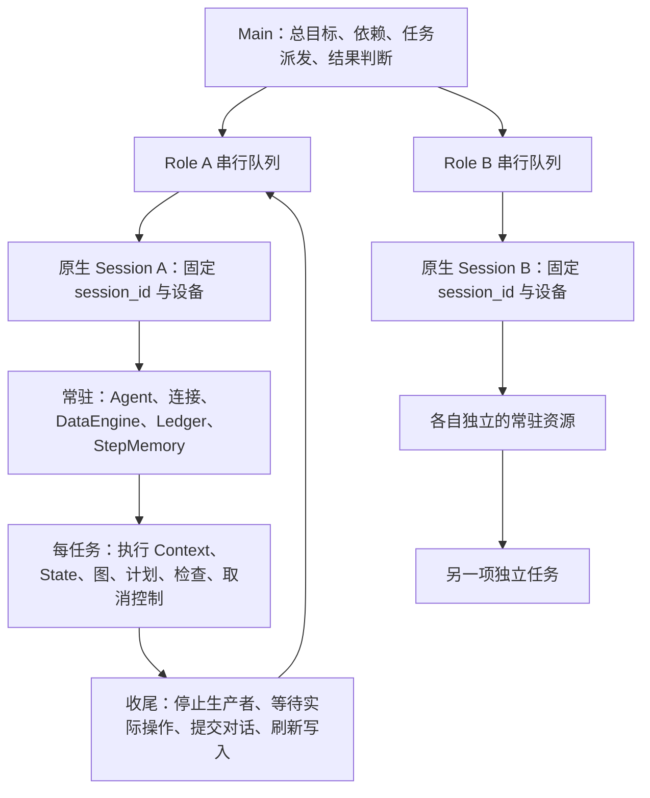

# 常驻 Role Session：多协程最小改造方案与多进程对比

更新日期：2026-10-21。

**本方案选择继续复用原生 Session：每个 Role 一个稳定的 `session_id`、一个 DataEngine 和一套会话记忆。任务和步骤增加归属标识；原生数据库、步骤、图片、trace 和记忆结构继续使用。**

大白话：A 发起工作时就贴好“A 的 Session、哪项任务、哪个步骤”的标签。日志排队、模型回答或摘要晚些回来时，按原标签记录，不再临时猜“现在轮到谁”。这叫归属传递，不是复制一份上下文或重做数据管理。

本文是最新设计与收敛计划，不表示建议中的接口、智能 Main 或重构已经实现。本次只更新文档，没有修改运行时代码，也没有重新测试设备。

## 1. 代码依据与实现状态

| 项目 | 核对版本 | 实际状态 |
| --- | --- | --- |
| 原生基线 | `351ca8422f7b5b54e80a9c1ce03a222e02415b6b` | 以此为准，不依赖旧 Role 切换或 Braden Lee 多设备改造 |
| 多协程分支 | `codex/persistent-role-coroutines`，`268ee08ff79db1dfab67387dd9fefd012082f316` | 已有常驻 RoleSession、任务队列、连续记忆、作用域、取消和收尾；没有智能 Main |
| 多进程分支 | `codex/master-child-sessions-implementation`，`79645915ddfc22de8f1d64830ec64d65b18c631e` | 已有 PersistentSession、worker、进程通信和模型驱动 Main |

多进程版本后面的协议草案和文档，不自动代表已实现接口。已有真实运行使用各自的 as-run SHA，不能用今天的分支头冒充重测版本。详见[双设备测试报告](session-comparison-real-devices-20261021.md)。

原生 Session 的生命周期由 Agent、Context、DataEngine 和图执行路径共同组成，并非现成的、可持续 submit 的完整对象。因此，复用原生 Session 仍需要补充“打开一次、多次执行、最后关闭”的生命周期。

当前代码证据：

- [RoleSession](../artemis/sdk/role_session.py)：常驻资源、串行队列、任务执行和关闭。
- [原生 Agent](../third_party/mobile_use/sdk/agent.py)：一次性任务入口与共用的 `_invoke_prepared_graph()`。
- [SessionDataEngine](../artemis/data_engine/session_engine.py)：继承原生存储，补任务归属、游标和读取范围。
- [TranscriptLedger](../artemis/memory/transcript.py)：`begin_task()` 更新目标前缀，保留已提交历史。
- [日志处理](../third_party/mobile_use/utils/logger.py)：入队时捕获所属 Engine、作用域、步骤和父 trace。

## 2. 目标与边界

1. 尽量少改原生执行算法和存储组织，方便后续合并上游。
2. Main 接受总目标、分配子任务、处理依赖；子 Session 只接收 Main 的任务并向 Main 返回结果。
3. 每个 Role 固定一个本地设备，连接、对话、记忆和业务笔记常驻。
4. 同一 Role 串行执行，不同 Role 在同一事件循环并发。
5. 完成或取消任务不关闭 Session；下一任务不继承旧坐标、动作队列、完成标志或检查结论。
6. 不把 `completed`、检查通过、真实业务成功混为一谈。

本方案不增加数据库必需列，不复制原生 Planner、Operator、Validator、Checker 或记忆压缩算法。进程重启后恢复完整内存会话、任意第三方工具的强制取消，不属于当前已交付能力。

## 3. 所有权与调度



此图中的智能 Main 是目标能力，当前协程分支尚未交付。已有固定流程示例只验证 Role SDK，不能冒充智能 Main 验收。

| 对象 | 生命周期 | 原因 |
| --- | --- | --- |
| RoleSession、串行队列、设备租约 | Session 常驻 | 保证一 Role 一设备；空闲时也不交出设备 |
| Agent、ADB/屏幕连接、原生 Driver | Session 常驻 | 避免每次任务重新连接或准备设备 |
| DataEngine、原生 session_id、原生步骤编号 | Session 常驻 | 所有连续任务属于同一会话，步骤编号继续递增 |
| TranscriptLedger、StepMemory、ChunkManager | Session 常驻 | 保留原生对话、摘要、压缩历史和确认事实 |
| 会话级客户端、共享业务笔记 | Session 常驻 | 账号、MeetingID、待确认事项继续可用 |
| 执行 Context、State、图、节点、工具包装 | 每任务新建 | 不继承旧执行缓存、旧目标、旧动作和检查状态 |
| TaskControl、ActionSession、后台生产者登记 | 每任务独立 | 取消只影响指定任务；迟到动作不能进入下一任务 |
| 任务计划、检查台账、结果、暂停与注入文件 | 每任务独立 | 防止覆盖或误用其他任务的内容 |

新建 Context 是新建执行外壳，里面引用同一套常驻连接、Engine 和记忆，不清空会话。相比逐项清洗同一个 Context，新外壳更不容易漏掉上游新增的任务字段。

当前协程实现采用新外壳，多进程实现采用 `reset_task_state()` 清理同一个 Context；两种方式都必须证明任务边界干净，不能只比较对象身份。

## 4. 按 session_id 归属，任务与步骤补充标识

| 标识 | 作用 | 何时需要 |
| --- | --- | --- |
| `session_id` | 属于哪一个常驻会话 | 所有会话记录 |
| `task_id` | 属于哪一次 Main 派发 | 任务执行、检查、结果及其后台工作 |
| `attempt_id` | 属于哪次执行尝试 | 精确取消、重试隔离与审计；当前 SDK 每次提交也会产生它 |
| `step_id` | 关联哪个原生步骤 | 步骤相关动作、模型调用和摘要；无步骤记录允许为空 |
| `trace_id` / 父 trace | 关联哪次具体调用 | 模型、工具和嵌套调用 |
| `role_id`、`device_id` | 展示和核验 Role/设备绑定 | 元数据补充；不代替 session_id |

一次任务可产生很多步骤；一个 Session 可以执行很多任务。单用 session_id 可以分开 A/B，但不能分开 A 的“登录”和“创建会议”，所以需要补任务、步骤标识。

### 4.1 最小传递方式

- 每个 Role 显式持有自己的 Engine；调用者有正确 ctx/Engine 时直接复用。
- 工作发起时捕获归属，入队、后台提交、模型调用开始时固定下来；完成时使用原归属。
- 队列项可以直接带 Engine 引用和轻量标识，也可以通过已有映射查找；不强制新增全局 Session 注册中心。
- 原生记录仍通过 Engine 写入；补充标识放入已有 step `extra_metadata`、trace `payload.execution` 等扩展位置。
- 新任务不通过修改全局 Engine、环境变量或 Engine 根目录来切换身份。

目标中的轻量 `ExecutionRef` 表示归属快照，不是新数据模型，也不携带完整 State、模型历史或资源生命周期。当前 `ExecutionScope` 还带有 Engine、控制器等运行时引用；可以先复用，只有减少耦合确有收益时再拆分，避免为了改名增加改动。

### 4.2 哪些交接处必须核对

| 交接处 | 必须保证 |
| --- | --- |
| 日志入队 → 后台消费 | 入队时保存所属 Engine 和标识；出队不查“现在的全局 Engine” |
| LLM 开始 → 结束/错误回调 | 用调用 ID 关联开始时的归属；不拿完成时的当前步骤覆盖 |
| 摘要提交 → 重试/完成 | 每个作业保留原任务、步骤或源步骤集合；跨任务压缩保留可追溯边界 |
| asyncio 子 Task | 继承创建时上下文；子 Task 的 ContextVar 修改不会自动传回父任务 |
| `asyncio.to_thread` | 会复制调用时上下文；取消等待不代表线程已经停止 |
| 手工线程池、外部回调、MCP 接收循环 | 不假设自动继承上下文；显式带快照或恢复执行上下文 |

ContextVar 是定位所属资源的辅助方法，不能代替归属快照、设备权限检查或收尾登记。已绑定正确 Context/Engine 的路径无需重复改造。

### 4.3 共享配置无需一律重构

相同模型、服务地址等只读配置可以共享。Role 独立的设备和执行参数通过对象或参数传递。环境变量作为启动默认值使用，不在任务切换时来回修改；队列票据等会被消耗的进程状态需要明确所有权。不存在“有全局变量就必须重写”的要求。

## 5. 原生数据怎么保留

```text
traces_path/
  data_engine.db                    # 原生数据库
  images/                           # 原生图片存储
  session_id/
    steps/                          # 原生连续步骤
    notes/                          # 原生共享业务笔记
    tasks/task_id/attempt_id/
      notes/task_plan.md
      notes/checker-*.md
      task_manifest.json
      task_result.json
      ...                           # 本次检查台账、结果、暂停和注入文件
```

不拆成每任务一个数据库，不在每任务开始时创建新原生 Session，不搬迁既有 steps/images。任务子目录仅隔离会互相覆盖的任务文件；具体命名可以调整，隔离语义必须保留。

### 5.1 会话回忆与当前证据分开选择

- 会话历史视图：读取本 Role 的原生历史，支持回忆业务事实、诊断和记忆压缩。
- 当前任务证据视图：按 task/attempt 选择本次步骤、检查记录和结果，作为当前任务验收的默认范围。
- 历史已确认事实可以被引用。例如此前已创建的 MeetingID 可以继续使用，但以前“创建成功”的 verdict 不直接变成本次“批准入会”的 verdict；历史坐标也不能直接恢复为待执行动作。

当前 SessionDataEngine 会根据作用域过滤通用读取函数，历史工具再切换为全会话读取。这能隔离数据，但隐式规则较多。收敛方向是明确的 `session_history()` / `task_evidence(task_id, attempt_id)` 入口或视图，共用原生存储，不新增第二套历史。

迁移顺序：先保留现有过滤并增加明确入口，逐个迁移消费者、验证检查边界，最后再移除不再需要的隐式覆盖。不能为了少改文件先取消过滤，也不要求所有节点增加一套新 reader。

### 5.2 连续性记录保持轻量

保留原生 Ledger、StepMemory 和共享笔记。每次任务开始更新静态目标前缀，并在对话里留下任务边界；任务结束提交最后一轮暂存对话，再接下一任务。

当前 SessionContinuity 还维护全量阶段记录、旧计划快照和最近八项结果注入。必要的是持续目标、当前任务、历史业务事实和可查的任务结果；完整旧计划复制、固定八项窗口不是协程必需项。

建议保留简短的阶段索引（目标、状态、结果摘要、原始文件引用），完整历史计划和结果继续使用原文件。共享笔记和索引的提示注入应有长度预算与显式截断说明。不能直接删除连续性提示，使旧任务目标在切换静态前缀后失去可追溯边界。

## 6. 任务生命周期、独立取消与收尾

正常流程：

1. Main 提交任务，Role 队列按序取出；创建 task/attempt 标识与执行外壳。
2. 更新当前目标，挂接同一原生 Ledger/StepMemory；新计划、检查、动作状态从空开始。
3. 调用原生 Pro 图；新 UI 动作依据当前观察生成。
4. 执行结束后结算生产者和检查，提交末轮对话，刷新记忆、日志和数据。
5. 保存结果并报告是否可复用；成功收尾后才取下一任务。

取消流程：

1. 按 task/attempt 精确匹配，排队任务取消后不启动；旧标识不能取消新任务。
2. 正在执行的任务先撤销新增设备动作权限，再取消执行与后台生产者。
3. 等待已发出的设备调用、线程、命令子进程及 ActionSession 真正收尾。`Task.cancel()` 不是手机动作回滚。
4. 记录已完成和被取消的检查，处理最后一轮暂存对话，刷新记录。
5. 无法在预算内确认收尾完成时，将 Role 设为 quarantined，拒绝新任务，保留设备租约和未完成工作的所有权。

结果分别表达任务执行状态、检查结果、业务结果和 `reusable/cleanup_errors`。取消接口的确认与实际收尾完成分别记录，不能以“已经发出取消请求”冒充“设备停止”。

当前原生控制台的 PID 级停止入口不能直接当作协程 Role 独立取消。接入时必须把精确的 Role/task/attempt 路由到 RoleSession 接口；锁归属也需包含设备或 Session，不能只按 PID 查找。

## 7. 接口与文件改动清单

以下名称中，`RoleSession.open/submit/cancel/close`、Ledger `begin_task()`、Engine `flush()` 已存在；其余标为“拟收敛”的名称表示接口职责，不表示已经新增或要求照此建立一整套类。

| 接口或职责 | 状态与处理 |
| --- | --- |
| `RoleSession.open/submit/cancel/close` | 保留现有 SDK；队列、设备绑定与资源所有权集中在此 |
| `prepare_session_resources()` / `close_session_resources()` | 拟收敛：共用原生准备和关闭能力，减少 RoleSession 对 Agent 私有字段的依赖 |
| `begin_task()` / `finish_task()` | Ledger 已有 begin_task；任务边界统一组织目标切换、末轮提交、检查与后台收尾 |
| `capture_execution_ref()` | 拟收敛：使用现有 scope 或轻量快照固定异步工作的归属，不建立第二套资源管理器 |
| `session_history()` / `task_evidence()` | 拟收敛：明确读取用途，共用原生存储；迁移后再删除重复隐式规则 |
| `flush()` 与操作登记/drain | 保留；等待写入不关闭会话，取消等待不遗忘实际工作 |

| 文件或模块 | 必须保留的能力 | 建议收敛方式 |
| --- | --- | --- |
| `sdk/role_session.py`、`third_party/mobile_use/sdk/agent.py` | 常驻生命周期、共用原生图入口 | 抽取少量资源准备/关闭接口；不复制整份 `_run_task()`，也不为了减少文件大改原生入口 |
| `context.py`、`runtime/session_runtime.py` | 常驻资源引用、每任务控制、设备操作追踪 | 保持执行外壳与共享资源边界；不通过重用整个 State 保留业务记忆 |
| `runtime/execution_scope.py` | session/task/step 归属定位与快照 | 优先显式 ctx/Engine；已有 scope 可继续复用，不强制注册中心 |
| `data_engine/engine.py`、`data_engine/session_engine.py` | 原生写入、可选全局发布、metadata、后台写入与 flush | 保留薄适配；减少依赖参数位置的覆盖，逐步集中读取范围 |
| `data_engine/scoped_reader.py`、历史与检查消费者 | 回忆完整 Session、本次检查独立 | 以明确视图替代分散的隐式 phase 判断，迁移时不放开证据边界 |
| `third_party/mobile_use/utils/logger.py`、`data_engine/trace.py`、`services/llm.py`、`tools/tool_wrapper.py` | 入队/开始时捕获归属、回调恢复、同步工具适配 | 共用归属辅助函数；已有正确 Engine 的路径不反复改 |
| `memory/transcript.py`、`memory/session.py`、`agents/operator/operator.py` | 原生 Ledger 组合、更新目标、末轮提交 | 保持少量公开接口，不访问 Ledger 私有字段 |
| `memory/step_memory.py`、`memory/chunking.py` | 摘要作业、压缩块和检查注释的原始任务归属 | 只改交接与边界；复用原生摘要/压缩算法 |
| `runtime/session_continuity.py` | 同一工作的连续任务提示、结果引用 | 缩减重复档案与提示内容，不复制完整历史体系 |
| `runtime/task_workspace.py`、`utils/notes.py`、检查及任务文件入口 | 共享业务笔记、任务文件隔离 | 集中路径策略；不在任务间改写 Engine 根目录 |
| `runtime/task_lifecycle.py`、`graph/graph.py`、`graph/checkpoints.py` | 图节点归属、末轮对应关系、取消后的检查记账 | 包装集中维护；现有节点名/注册器依赖在上游升级时明确检查 |
| `drivers/*`、`mcp/action_*`、`tools/command_tool.py`、相关 Controller/Checker | 动作权限、阻塞转移、线程与子进程收尾 | 受控设备入口为主，直接绕过 Driver 的调用逐个核对；不能只改顶层 await |
| `runtime/device_lock.py` | 精确设备租约、避免消耗他人票据 | 设备/Session 归属明确；不把 PID 当作唯一 Role 身份 |
| Explorer、VideoAnalyzer、ObjectDetector 等客户端/后台入口 | 客户端所有权与后台生产者登记 | 仅保留资源和收尾接入，决策算法继续原生复用 |

原生 SQLite 初始化、事务与共享数据库写入能力也需要验证。如果同时启动多个 Engine 存在初始化竞争，优先使用窄范围启动锁；不以此为由重写原生 StorageManager。

Luna/Codex 路由、辅助模型配置、Windows 静态文件 MIME 和后端超时预算属于公共适配，单独维护，不计入协程机制的必要成本。

## 8. 智能 Main 如何接入

当前协程 SDK 缺少智能 Main。本方案补充的是目标边界，不把脚本派发称为智能编排：

- Main 接收总体目标和 Role/设备绑定，模型提出任务、依赖及所需结果；程序校验后派发。
- Main 维护业务依赖和已确认事实，按结果决定后续任务；Role 不直接相互调用或修改对方状态。
- Role 执行接口覆盖提交、等待结果、查看状态、取消和关闭。若需要 inspect/observe，另行明确只读权限、空闲/运行时行为和输出范围，不能用并发观察绕过 Role 串行设备入口。
- 可评估复用多进程 Main 的业务模型、规划和调度逻辑；通过后端适配层将 worker 消息替换成 RoleSession 调用。现有 Main 与 worker 生命周期、协议及验收逻辑有关联，不能承诺换个函数名即可直接复用。
- 合同验收、重试策略、事实失效和恢复属于业务编排能力，两种执行机制都可能需要，不能全部算作多进程必需成本。

会议示例：A 登录 → A 创建会议并返回 MeetingID → Main 同时派 B 提交申请、A 等待并批准 → B 确认入会 → A 给 B 发消息。

B 的“提交申请”任务在已提交时结束，不等待批准；A 的批准任务不等待 B 后续确认，避免循环等待。B 已提交申请、A 已批准、B 已确认入会是三个不同事实。A 所有任务沿用同一个 Session。

## 9. 协程与多进程：改动对比

按相同业务能力比较，而非直接比较两个分支总行数。

| 项目 | 多协程最小方案 | 每 Role 一个常驻进程 | 成本归类 |
| --- | --- | --- | --- |
| 常驻 Session 生命周期 | 打开一次、执行多次、最后关闭 | 同样需要 | 共同 |
| 保留历史，更新目标，清理动作和结论 | 新执行外壳复用原生记忆 | 当前实现清理复用 Context | 共同需求，实现不同 |
| 任务计划、检查、结果隔离 | 任务目录与补充标识 | 同样需要任务边界和归档 | 共同 |
| 原生算法和数据库 | 复用，不要求改表 | 同样可以复用 | 两边都不必重写 |
| Session 级 Engine 归属 | 同进程内显式区分各 Role | 每 worker 通常仅一个 Role，进程内全局状态自然分开 | 协程接入更多 |
| 日志、回调和摘要归属 | 处理跨 Task、线程、回调的 Session/任务/步骤归属 | 仍须处理同一 Session 前后任务和迟到记录；跨 Role 风险更小 | 协程接入更多 |
| 固定公共配置 | 只读共享即可 | 各进程加载 | 都不必重构配置体系 |
| 独立设备/任务参数 | 显式对象和参数，不修改共享环境 | 可通过 worker 参数和环境传入 | 协程要避免共享可变状态 |
| 同步阻塞操作 | 移出共享事件循环，并持有实际操作 | 通常只阻塞所属 worker；worker 的心跳/取消仍可能受影响 | 协程要求更严格 |
| 正常取消和收尾 | 任务权限、登记、drain、隔离 | 同样需要；另外可终止特定 worker | 共同能力，故障手段不同 |
| Main/Child 通信 | 直接调用、队列、Future | 序列化、协议、连接和消息匹配 | 多进程额外 |
| 子 Session 运行管理 | 协程、队列和资源管理 | 还需要进程启动、退出、断连与监督；重连/重发依产品要求增加 | 多进程额外 |
| 智能 Main 与业务验收 | 目标方案需要；当前分支缺失 | 当前分支已实现模型规划和结果消费 | 功能差异，不是机制差异 |
| 白屏、无 API Key、Luna 调度 | 共用公共适配 | 共用公共适配 | 与机制无关 |

### 9.1 各自的优缺点

| 维度 | 多协程 | 多进程 |
| --- | --- | --- |
| 常驻资源 | Role 解释器数量较少；仍可能有 I/O 线程和模型 CLI 子进程 | 每个 Role 多一份解释器和运行时资源；实际内存需测量 |
| 调度与传结果 | 直接调用，省去进程通信协议 | 有进程边界，需要消息传递和生命周期管理 |
| 故障隔离 | 共享事件循环和进程；阻塞、崩溃或未隔离状态可能影响其他 Role | 单 worker 故障通常更容易隔离；共享文件、SQLite、ADB daemon 仍可能共同受影响 |
| 卡死操作 | 无法安全强杀 Python 线程；未结束时必须保留租约并隔离 Role | 可结束特定 worker；已发到手机的副作用仍需重新观察 |
| 原生修改面 | 需贯穿隐式 Engine、日志、回调和操作交接点 | 很多进程全局状态可沿用，修改较容易集中在生命周期与外层 |
| 自有代码成本 | 归属和收尾适配需要长期维护 | worker、协议和故障监督需要长期维护 |
| 上游升级重点 | 新入口是否绕过归属、是否有新增阻塞或未登记后台操作 | 原生生命周期接口与进程通信层兼容性 |
| 现有交付范围 | 常驻 Role SDK，智能 Main 待完成 | 有真实 Main/worker 链路，但不能据此认为完整业务已验收通过 |

当前两分支功能范围不同，包含不同测试和公共修复，不能用总行数或文件数直接判断哪种方案更简单。工程上的趋势是：协程节省常驻解释器和通信管理，代价是更多原生并发交接适配；多进程增加外层管理，换取更自然的进程内状态隔离。此判断基于代码，不是吞吐量或稳定性保证。

## 10. 最小验证与验收标准

| 验证项 | 方法 | 通过标准 |
| --- | --- | --- |
| 并发日志与 trace | A/B 同时调用模型、写步骤；故意延迟日志消费和回调 | session/task/step/父 trace 对应原始发起者；无归属记录不猜 Role |
| 归属传播边界 | 覆盖 asyncio Task、to_thread、手工线程池、回调与 MCP 接收循环 | 必要标识不丢失；子 Task 游标不依赖反向 ContextVar 传播 |
| 连续任务与目标切换 | 同 Role 登录后创建会议，或计算后继续运算 | Session 和记忆保留；目标、State、动作、完成与检查状态更新 |
| 最后一轮对话 | 在 Operator、步骤记录、Validator 前后分别结束/取消 | 暂存对话按已完成节点关联，不补用上一轮 Validator 结果 |
| 检查隔离 | 两次任务使用相同检查 hash；分别通过/失败 | 旧 verdict 不自动通过新任务；历史事实与本次验收明确区分 |
| 独立取消 | 分别在排队、LLM 等待和设备操作阶段取消 A，B 继续 | A 不再发新动作，B 不被连带取消；确认与收尾时间分开 |
| 取消后复用 | A 实际收尾后同 Session 再接任务 | 重新读取设备状态；无旧动作/旧写入落到新任务；未知效果不假设回滚 |
| 不能取消的底层操作 | 阻塞设备线程/迟到进程创建，触发收尾超时 | Role 隔离并持有租约；实际结束后可重试关闭，不伪装空闲 |
| 设备与暂停归属 | A/B 不同设备、相同 PID；仅暂停或取消 A | 锁绑定正确设备，B 不暂停，第三方不能抢占尚未释放设备 |
| 存储启动与关闭 | 并发启动 Engine；延迟写入/日志/IPC 后关闭 | 原生数据库有效，必要时初始化串行；工作收尾后释放资源 |
| 有界资源 | 多任务循环、长期笔记、句柄与摘要作业观察 | 不无界重复持有完整任务快照；有清理/保留策略和提示预算 |

先做隔离与取消回归，再做两手机业务 Case。各取消阶段独立统计，未实际覆盖就标记未验证。采集 Session、任务、步骤、设备标识、时间线和截图；分别统计运行状态、检查结果与业务结果。审计最终状态，不能拿运行中的快照证明收尾成功。

既有双设备测试是[历史证据](session-comparison-real-devices-20261021.md)，并非本方案收敛后的验证。报告记录了有限场景的取消与复用，也明确了完整业务失败和未覆盖项；本次不新增性能或稳定性结论。

## 11. 建议实施顺序与升级维护

1. 冻结当前行为和隔离用例，先列出每个异步交接的归属来源、后台工作所有者和文件位置。
2. 统一“原生 session_id + 任务/步骤补充标识”的表达，复用现有 Context/Engine/scope；不为表达归属再建一套业务数据。
3. 将日志、回调、摘要的捕获/恢复辅助逻辑集中；保留设备权限和收尾屏障。
4. 缩减重复连续性档案，逐步明确会话历史与当前证据读取入口。
5. 只抽取确实能供一次性和常驻入口共同使用的生命周期接口，避免为少改表面文件而大改原生 Agent。
6. 智能 Main 单独交付和验收，再做同能力的多进程/协程对比。

上游升级优先核对 Agent 生命周期、Context 新字段、图节点注册/执行形式、Ledger 公共接口、Engine 写入签名、模型回调和设备入口。当前用位置参数识别 `record_step` metadata、依赖节点名称包装图等适配点值得收敛；改动后要证明原来的保护仍成立。

以最少触及原生模块为第一优先级，多进程仍有自然优势；以减少常驻解释器和直接调度为主要诉求，协程有合理价值。按本文路线，协程无需重构整个 Artemis，但仍有归属和取消的接入成本。是否值得选择，应在功能范围一致后结合实际资源与故障需求判断，不承诺升级永远无冲突或预设性能胜负。
