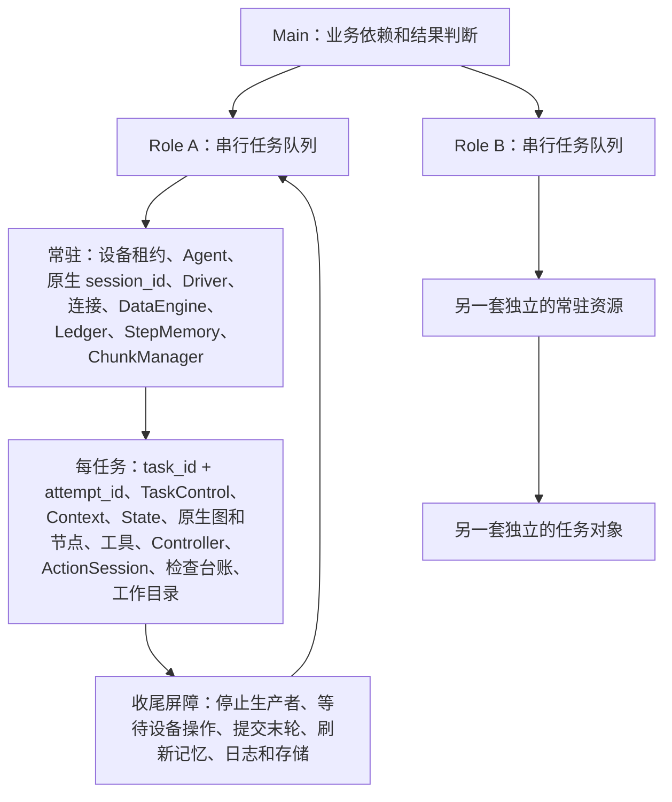

# 常驻 Role Session：多协程实现

> 本文记录当前实现。最新收敛设计见[多协程最小改造方案与多进程对比](persistent-role-coroutines-minimal-plan.md)：按原生 session_id 归属会话，以任务和步骤补充标识，保留原生存储组织。该文中的拟调整接口尚未表示已实现。当前协程分支提供 Role SDK，智能 Main 尚未实现；下文 Main 表示调用方承担的编排职责。

本分支以 `351ca8422f7b5b54e80a9c1ce03a222e02415b6b` 为基线，新增
`artemis.sdk.RoleSession`。Main 在同一事件循环内编排多个 Role；同一 Role 的任务通过队列串行执行，
不同 Role 可以并发。原有 `Agent.run_task()` 继续提供一次性任务入口。

复用了 `788bc0f3536662966139c196811d6460f49432df` 中作用域、日志入队归属快照、
DataEngine 适配和动作队列检查的思路；没有引入该提交的单个活动 Role、共享任务计划或 Role 切换路由。
这是功能性适配，不是将整个提交合并到本分支。

## 对象所有权



| 常驻对象 | 边界 |
| --- | --- |
| RoleSession / worker / 队列 | 一个 Role 固定一个设备；必须在创建它的事件循环使用 |
| DeviceExecutionLock | 从 open 到真正关闭资源始终持有；空闲也持有设备 |
| Agent / ADB / 屏幕连接 / Driver | 初始化、解锁检查和设备环境准备只做一次 |
| SessionDataEngine | 一个原生 session_id，步号连续；不在任务间改写 base_dir 或 session_id |
| TranscriptLedger | 保留已提交对话、冻结历史和压缩结果；每任务更新系统提示前缀 |
| SessionContinuity | 保留长期目标、共享工作笔记和阶段结果；每次派发是同一工作的下一阶段 |
| StepMemory / ChunkManager | 保留已完成的记忆；后台作业和压缩块保留原任务归属 |
| 原生 GenAI 客户端 | 按 Role 复用，由 Role 关闭；不跨事件循环 |

| 每任务重建 | 不允许继承的状态 |
| --- | --- |
| ArtemisContext / State | 坐标、待执行动作、完成标志、注入指令、检查结论、planner 反馈 |
| 原生 Pro 图、节点、LLM/工具包装、Controller | 节点局部缓存、计划、当前目标、视频分析黑板 |
| TaskControl / ActionSession / 后台任务注册表 | 动作权限、动作队列、检查尝试和任务进程 |
| 工作目录 | task_plan、checker 笔记、检查流/台账、run_outcome、output、暂停文件、任务结果 |

普通笔记保留在 Role 根目录 `notes/`；`task_plan`、`output`、`checker-*` / `checker:*`
保留在任务目录。新的任务仍可回忆历史，但历史不能直接成为当前任务的执行状态或检查证据。
这里重建的是执行 Context 外壳，不是清空模型对话。账号、MeetingID、已确认进展和待确认事项
继续留在同一个 Role 的 Ledger、记忆和普通笔记中。
Role 生命周期内保存任务句柄和历史；本实现不提供进程重启后的 Session 恢复或自动休眠。

### 连续任务的工作主线

`open(session_goal="协调 A、B 完成同一会议中的操作")` 可设置 Role 的持续目标。
每次提交仍有独立的当前目标和验收条件，模型同时看到持续目标、共享笔记、最近阶段结果与当前派发。
当前派发控制下一步执行；不会因新建 State 而要求重新登录或重复创建会议。

- `notes/session_context.md`：原生笔记工具可持续更新的工作记忆，保存业务标识、证据引用、长期进展和未确认事项。
- `notes/session_progress.md`：运行时维护的完整阶段记录，包含目标、终态、报告结果、历史计划快照及任务目录；旧计划不会装回当前执行计划，也不能充当当前检查通过的证明。
- 提示中自动显示最近 8 个阶段；过长的单项输出以明确标记的摘要片段展示，完整值在上述笔记及各任务结果中。
- 连续工作信息通过 Ledger 的公共 context provider 注入，不属于被压缩的历史区；旧对话继续使用原生压缩。
- 取消只表示本次派发终止，未观察到的业务效果仍未知。Main 应区别提交申请、批准申请和确认入会，不能把通用 completed 等同于全部业务完成。

工作主线有持久记录和明确的提示边界，但不会自动把模型输出提升为已验证事实；真实设备与模型的阶段判断仍需验收。

## SDK 接口

```python
from artemis.sdk import RoleSession

async with await RoleSession.open("A", "explicit-adb-serial") as a:
    login = a.submit("登录应用", task_id="login")
    result = await login.result()
    if result.status == "completed" and result.reusable:
        next_task = a.submit("创建会议并返回 MeetingID")
        result = await next_task.result()
```

- `RoleSession.open(role_id, device_serial, config=None, traces_path=None,
  cleanup_timeout=30, lease_timeout=60, event_queue_size=256, session_goal="")`：获取租约并初始化常驻资源。
  只支持显式本地设备和原生 Pro 图，拒绝 Cloud Mode、自动选设备和跨事件循环调用。
- `submit(TaskRequest | str, task_id=None) -> TaskHandle`：排队；复制请求，产生唯一 attempt_id。
  同一 Role 内不接受重复 task_id；重试用新的 task_id，原结果仍可查询。
- `await handle.result() -> RoleTaskResult`：等待结果。取消 Main 的等待者不会隐式取消子任务。
  Main 自己设置超时后，需明确调用 `cancel()`。
- `await cancel(task_id, attempt_id)`：只取消匹配的尝试。旧 attempt 不会取消新任务；排队任务立即返回取消结果。
- `resume(task_id, attempt_id)`：只移除当前尝试的暂停文件。
- `await close()`：停止接收任务、取消队列和当前执行，等待资源退出后释放设备。
  关闭期间被外部取消时，也会保留内部清理任务的所有权。
- `events`：有界 `asyncio.Queue`，在创建 Role 的事件循环消费。未及时消费时淘汰最早的实时事件，
  `dropped_events` 计数；任务句柄和持久化数据是权威结果，不依赖实时事件队列。

`RoleTaskResult.status` 是 `completed / failed / cancelled`；`reusable` 独立表示收尾是否成功。
`completed` 但 `reusable=False` 也不能向该 Role 继续派任务。`error`、`cleanup_errors`、`workspace`
保留诊断信息；完整原生检查结果在 `state.run_outcome` 和任务文件中。

底层设备调用或线程不能被 Python 强行停止。取消会撤销新的动作权限，等待已开始的操作；超时将 Role
置为 `quarantined`，拒绝后续任务并保留租约。操作真正退出后可以再次 `close()`。
关闭超时也保留清理任务，重试 close 会等待同一个资源关闭任务。
存储 flush 的等待者被取消时，实际写入仍保持登记；下一任务不能越过未结束的写入。
日志消费和 IPC 发送各由所属 Engine 的独立工作队列持有，A 的阻塞不会占住 B 的日志消费者。
每个队列使用辅助 I/O 线程，不运行独立的 Role 事件循环；Role 执行仍在同一个 asyncio 循环。
IPC 阻塞仍可使它所属的 Role 收尾超时并隔离，不以超时为理由遗忘发送工作。
检查任务在结果或取消状态完成记账后才移出登记。最后一轮对话只关联当前轮已完成节点的
step/Validator 结果，取消前未获得的结果不从上一轮补齐。
如果启动失败且清理未完成，会抛出 `RoleSessionOpenError`，通过异常的 `session` 属性重试关闭。
不应以 PID 信号或旧的 PID 级取消标记实现某个 Role 的独立取消。

Role 的 trace 根目录由 `open(traces_path=...)` 控制；TaskRequest 的一次性 trace 打包、重命名、删除和
远程 trace 上传流程不在此入口执行，避免销毁常驻历史。现有 CLI、管理控制台、Cloud Gateway 尚未接入此 SDK。
如果外部程序要调用，须自行将精确的 Role/task/attempt 路由到上述接口。

## 存储与上下文

目录保持原生数据库结构，只在原生会话目录下增加任务空间：

```text
traces_path/
  data_engine.db
  images/
  session_id/
    notes/                         # Role 普通笔记
    steps/                         # 原生连续步骤
    tasks/task_id/attempt_id/
      notes/task_plan.md
      notes/checker-*.md
      task_manifest.json
      task_result.json
      ...                          # 原生检查台账、run_outcome 等
```

没有给原生表增加必需列。步骤 `extra_metadata`、trace 的 `payload.execution` 和事件附带
role/session/task/attempt/device 标识。默认步骤、截图和压缩块读取限制在当前 task/attempt；
仅 Operator 的显式历史回忆工具和记忆压缩服务可以读取本 Role 全部历史。
检查仍使用原生 Checker 和检查台账，每任务从空状态开始。相同 checkpoint hash 也不能复用上次 verdict。

`ExecutionScope` 是不可变 ContextVar 值；它负责定位资源，不能代替生命周期管理：

- asyncio 子 Task 自动继承创建时快照；`to_thread` 自动复制；手工存储线程显式 `copy_context()`。
- LangGraph 节点之间不会反向传播 ContextVar 修改，因此主执行游标由 TaskControl 显式传递；
  检查子任务维持创建时的游标。
- 日志在入队时捕获 Engine、scope、step 和父 trace；后台线程不再出队后查全局 Engine。
- MCP 的服务端接收循环也不会自动继承客户端请求上下文，因此串行队列携带完整 Context 快照，
  服务端工具入口再恢复，动作派发前再次验证权限。
- LLM 回调、TraceSpan、StepMemory 作业、压缩块保存原始归属，延迟完成也不会落到下一任务。
- SessionDataEngine 不写入原生全局 Engine；没有作用域的日志不会猜测某个 Role。
- 原生全局配置和环境变量按进程配置使用；不在 Role/task 切换时修改。输入配置做独立快照。

任务结束会先停止检查、planner、诊断等生产者及命令进程，关闭 ActionSession，等待已派发设备操作，
再停止录像、提交 Ledger 暂存末轮、刷新 StepMemory/压缩、关闭任务 MCP 连接，最后等待日志队列与
DataEngine 写入。持久化失败会使 Role 隔离；已报告的写入失败不会阻止后续关闭、释放已停止的设备。

原生部分 SQLite/小文件读取仍同步执行；已将 IPC 发布、初始化、主要屏幕获取和同步工具移出事件循环。
这不保证任意第三方扩展都没有阻塞 I/O。新增工具若直接访问 ADB/线程，必须走 TaskDriver、TaskControl.own
或对应受控入口；不能创建无法追踪的后台设备任务。

## 上游合并边界

新增核心模块：

| 文件 | 接口和职责 |
| --- | --- |
| `artemis/sdk/role_session.py` | RoleSession、TaskHandle、RoleTaskResult、RoleSessionOpenError；队列和生命周期 |
| `artemis/runtime/execution_scope.py` | ExecutionScope、作用域恢复、Engine/暂停文件解析、设备权限验证 |
| `artemis/runtime/session_runtime.py` | SessionResources、TaskControl、TaskDriver；原生 Ledger 组合根 |
| `artemis/runtime/task_lifecycle.py` | 图节点作用域、当前轮执行结果关联、取消后的检查记账 |
| `artemis/runtime/background_work.py` | 持有实际线程工作，取消等待不取消工作；每 Role 日志与 IPC 队列 |
| `artemis/runtime/session_continuity.py` | 持续目标、共享工作笔记、阶段结果档案与当前派发的提示 |
| `artemis/memory/session.py` | 从 Operator 提取的公共 Ledger 创建入口，复用原生 StepMemory 和 ChunkManager |
| `artemis/runtime/task_workspace.py` | 标识校验、任务目录解析、原子 manifest 写入 |
| `artemis/data_engine/session_engine.py` | SessionDataEngine；任务游标、写入归属、隔离读取、后台写入追踪 |
| `artemis/data_engine/scoped_reader.py` | Operator 的显式历史读取适配 |

原生文件的扩展点：

| 文件组 | 变更 |
| --- | --- |
| `context.py`、`sdk/__init__.py` | 显式资源所有权字段；导出新 SDK |
| `third_party/mobile_use/sdk/agent.py` | 抽出 `_invoke_prepared_graph()` 共用原生图执行；保存预热任务；异步尺寸读取 |
| `graph/graph.py` | 一个 managed 接入点；包装实现集中在 runtime/task_lifecycle，保留原生节点、边和判断 |
| `memory/transcript.py`、`agents/operator/operator.py`、`memory/__init__.py` | 公开 begin_task；复用稳定 Ledger/StepMemory；新任务重建当前目标前缀 |
| `memory/step_memory.py`、`memory/chunking.py` | 作业和 chunk 原始归属；跨任务 chunk 分段及检查注释隔离 |
| `data_engine/engine.py` | start_session 可不发布全局；公开 flush；设备锁精确标注 |
| `services/llm.py`、`tools/tool_wrapper.py`、`utils/notes.py`、`data_engine/trace.py`、原生日志模块 | 作用域解析、队列/回调快照、任务暂停与同步工具隔离 |
| `graph/checkpoints.py`、`graph/perception.py`、`utils/task_tree.py`、Outputter/Diagnoser | 任务文件路由；图片写入纳入屏障 |
| `mcp/action_session.py`、`mcp/action_server.py` | 队列快照、服务端恢复、权限复核、启动前发布所有权、受控关闭 |
| `drivers/factory.py`、`drivers/android/adb_driver.py`、`tools/base.py`、`tools/command_tool.py`、Checker | 受控 Driver、线程操作追踪、同步 I/O 转移 |
| `controllers/unified_controller.py` | scrcpy 创建时登记进程；即使创建的等待者被取消，也能回收子进程 |
| `runtime/device_lock.py` | 按设备而非 PID 标注租约；不消费其他 Role 的环境队列票据 |
| Explorer / VideoAnalyzer / ObjectDetector | 客户端资源归属；后台任务纳入收尾 |

Planner、Operator 决策、Validator 执行、Checker 判定及图路由本身继续复用；没有复制一套执行算法。
上游升级优先检查原生图入口、Ledger 公开生命周期、Context 字段、DataEngine 的读写签名和 MCP 入口。
记忆压缩与原生图流式执行的接口变化最值得做回归，不能承诺升级永远没有冲突。
本次没有进一步改写压缩算法。Ledger 创建代码移到公共组合根而非复制一套；上游若修改原来的创建逻辑，
应对照同步到 memory/session.py。原生检查登记和 DataEngine flush 的取消修复也适用于一次性入口，
保留为小范围修正，不用 Session 子类复制整套检查调度。

review 回归新增：取消正在 flush 的写入仍持有工作与租约；A 的日志或 IPC 阻塞时 B 独立收尾；
检查结算取消后已完成与取消的检查都恰好记账一次；Operator/记 step/Validator 三个取消窗口不引用上一轮结果；
新派发保留 Session 目标、MeetingID 和进展，同时不继承旧 State/计划，压缩后连续工作提示仍存在。

## 验证

新增测试位于 `tests/unit/sdk/test_role_session.py` 和 `tests/unit/runtime/test_execution_scope.py`：

- 同 Role 连续任务串行、跨 Role 并发；连接初始化一次，历史/笔记保留，任务 State 和游标重置。
- 实际 LangGraph 调度和原生流式执行入口，验证 State 类型和跨节点步号传递。
- 真实 SQLite 并发 trace/日志归属；延迟日志消费、手工线程、回调和 MCP 传输边界。
- 任务计划、步骤、截图入口、检查台账、chunk 和暂停文件隔离；同 hash 不跨任务合并。
- 独立取消、旧 attempt、排队取消、Main 等待者取消、重复取消、底层线程超时仍持有操作。
- 启动取消、后台生产者退出、末轮提交、写入失败隔离和设备租约延迟释放。

```powershell
$env:GOOGLE_API_KEY='test-not-a-real-key'
python -m pytest tests/unit/sdk/test_role_session.py tests/unit/runtime/test_execution_scope.py -q
python -m pytest tests/unit -q
```

新增测试只在各自 fixture 内启用假模型，隔离真实设备。不要全局启用 ARTEMIS_FAKE_LLM 后执行模型工厂实例测试。
本 Windows 主机的原生 readiness 强制刷新测试会因单调时钟分辨率失败；已将基线文件取出独立执行，确认基线同样失败。
真机、真实模型、长时间运行及每个第三方插件的设备取消行为仍需集成验收，单元测试不能替代它们。

本次全量回归：2534 passed、7 skipped、1 failed；唯一失败为上述基线 readiness 用例。
相关记忆、存储、Operator、检查和 Role 回归为 287 passed；最后补充历史计划快照后，
32 项隔离/生命周期测试再次全部通过。Ruff 和 diff 检查通过，会议示例的 `--help` 入口检查通过。

会议场景见 `examples/persistent_roles.py`：A 登录和创建会议后，Main 并发派 B 提交申请与 A 等待批准；
B 的任务在“已提交申请”结束，随后单独确认“已经入会”。A 的全部操作沿用一个常驻 RoleSession。
