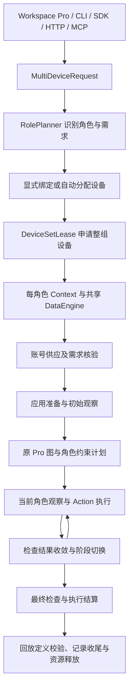

# Artemis 项目优化总体设计

本文以当前通用生产代码为依据，统一说明 Pro 多设备执行、账号资源供应、Action 数据绑定、证据归属和诊断日志。长期 Case 管理、云端保存与测试批次的产品设计见 [Case 管理设计](case-management-design.md)。

## 1. 目标与实现边界

优化目标是让一个 Case 能可靠地驱动多个真实设备，并留下可检查、可继续加工为回放定义的执行记录。设备、角色、阶段、动作与数据来源必须可以分别追溯。

实现沿用原有 Pro 图、Markdown task_plan、Operator、Validator、Checker、ActionSession 和 DataEngine，在必要边界增加角色与数据上下文。一个 Case 可以只有一个角色，也可以有多个角色，数量由场景决定。

| 能力 | 当前状态 |
|---|---|
| 从 Case 规划角色、分配不同设备、申请整组租约 | 已实现 |
| 同一 Case 中按 milestone 切换设备 | 已实现，设备动作串行执行 |
| 每个角色独立的观察、节点与历史 | 已实现，共享计划和数据引擎 |
| 按角色归属检查证据、处理迟到结果和最终复核 | 已接入现有 Checker 流程 |
| 根据 feature 需求供应账号并注册运行时字段 | 已提供可信宿主回调；账号池由调用方实现 |
| Action 输入引用、输出发布、来源与依赖校验 | 已实现 |
| 生成安全回放中间定义及完整性问题列表 | 已实现 |
| 验证码等业务结果提取 | 使用接入方的提取方案，只提供结果发布接口 |
| YAML 写入、成功路径提炼、自动回放调度 | 尚未实现 |
| 长期 Case、云端独占控制、可靠上传、测试批次 | 产品方案已设计，尚未由当前执行接口实现 |

当前 `/api/cases` 中的标识是一次执行的 run_id。它不能等同于长期 Case 管理设计中的 case_id，也不代表已实现云端多用户权限和同步。

## 2. 核心对象与不变量

| 对象 | 责任 | 约束 |
|---|---|---|
| RolePlan / RoleSpec | 描述参与者身份、Case 中的对应人物和 feature 需求 | 身份在本次执行中固定；角色不按动作命名 |
| DeviceSpec | 将角色绑定到实际 serial，并提供已验证准备信息 | 一角色一设备；不同角色不能共用 serial |
| AppProfile | 指定被测应用、环境说明及可选 APK | 由请求显式提供，不按设备型号猜测测试应用 |
| task_plan / milestone | 表达阶段、子目标和检查项 | 顶层 milestone 绑定一个角色，子项继承 |
| ExecutionScope | 标记正在执行的角色、设备、阶段与证据归属 | 异步调用和队列不能依赖变化中的全局当前设备 |
| Action | 一次实际工具或设备操作意图 | 以 action_id 识别，重试增加 attempt |
| ValueBindings | 保存一个 Run 内的数据定义及运行时实际值 | 所有角色共享同一实例，字段访问受角色约束 |
| DataEngine | 持有 session、步骤、trace 和绑定记录 | 多设备共用一个引擎，实际值不进入安全定义 |

A→B→A 表示两个角色参与三个阶段。设备切换由计划当前阶段决定，不能通过 Android Guest 或用户 profile 冒充第二台物理设备。

milestone 负责业务阶段，Action 负责实际生产和消费数据。“验证码登录”可以保持一个 milestone，其中取验证码与输入验证码通过 Action 引用关联，不需要为数据传递拆分阶段。

## 3. 请求入口与整体执行流程

`MultiDeviceRequest` 包含 case、可选 role_plan、role_bindings、preferred_device、app_profile、feature_catalog、执行预算和录像开关等字段。请求模型不承载账号供应回调或临时凭据。

| 入口 | 处理方式 |
|---|---|
| 普通 `/api/run` 与任务队列 | 本地 Pro 延后单设备选择，进入角色规划；普通请求禁止注入角色绑定字段 |
| CLI 原 Pro 路径 | `execute_task` 在本地非云模式委托 MultiDeviceAgent |
| SDK | `MultiDeviceAgent.run_case` 接受统一请求，可注入可信 binding_preparer |
| CLI `run-case` | 读取 JSON 请求，执行 SDK，返回机器可读结果 |
| HTTP `/api/cases` | 提交、查询、取消一次执行及读取角色录像 |
| MCP `mobile_run_case/get_case/cancel_case` | 复用相同 jobs 实现 |
| ArtemisClient | 包装提交、查询和停止执行的 HTTP 协议 |

jobs 为每次提交创建 run_id，在独立后台进程执行 `run-case`，保存请求、进度和结果。状态读取同时检查进程身份，使用 PID 与创建时间降低 PID 复用误判。路径入口约束 run_id 为 UUID，录像下载检查文件位于对应执行目录内。

## 4. 角色规划、设备分配与账号供应

### 4.1 规划与分配

`plan_roles` 复用 Planner 模型及 fallback，也接受调用方提供的 RolePlan。它检查角色唯一性、显式绑定集合、未解决歧义以及 feature ID 是否属于目录；不执行设备操作。

`allocate_roles` 从在线设备中按首选设备、忙闲状态和 serial 排序，一对一绑定角色。设备不足或指定设备离线会失败，不能缩减角色数量以凑合执行。分配器目前不负责按硬件能力或账号属性匹配设备。

`DeviceSetLease` 复用既有设备锁，按稳定顺序申请整组设备。一台申请失败时释放已持有设备，再在预算内重试，避免部分占有形成死锁。取消和超时进入释放流程。全局并发限制以 Case/session 计数，不把同一 Case 的多个设备误算成多个任务。

### 4.2 feature 需求与账号字段

需求描述“需要什么账号”，运行时字段描述“这次实际分配到了什么”。两者不能混用。

1. RolePlanner 生成合法的 feature_requirements。
2. SDK 建立共享绑定实例，调用可信 `binding_preparer(bindings, role_plan, request)`。
3. 供应器选择并验证实际账号，通过 `register_fixture` 注册字段与满足情况。
4. SDK 核验尚未由 prepared_features 证明的需求；同一角色的一个资源必须满足全部剩余需求。
5. 空供应、属性不匹配或角色错误在 Case 动作开始前失败。

没有 binding_preparer 时，仍要求调用方通过 prepared_features 证明需求已准备。`register_fixture.requirements` 是可信供应器对实际资源的声明，不能直接复制请求而不验证。SDK 本身没有账号服务验证能力。

资源注册一次性绑定邮箱、密码等字段；同一角色同一资源不能覆写。引用形如 `roles.<role>.account.email`，来源同时保留资源、字段、provider 和 requirements。实际邮箱与密码只进入运行时值表。

跨角色共享字段需要显式 field_roles。例如允许另一角色使用公开邮箱，不意味着允许它读取密码。密码没有特殊的按字段名替换逻辑；任何字段的保存方式都由注册来源决定。

## 5. 计划、回合与设备隔离

`RoleBindingValidator` 校验顶层 `[role:ID]`、子项继承、单一活动 milestone 和完成归属。角色不能完成其他角色的阶段，也不能删除已完成阶段的身份或悄悄更换活动角色。

计划仍以 Markdown 文件为权威。`MultiDeviceRuntime.commit_plan` 在锁内比较读取前的内容、验证修改，再原子替换文件并递增 plan_revision。冲突时要求重新读取。

每个角色有独立 Context、设备连接、节点实例和历史状态。Case 共享计划、检查结论、笔记及 DataEngine。共享业务事实不能使其他设备的坐标变成当前设备坐标。

`begin_turn` 先收敛前一阶段检查，再选择当前角色、恢复其状态并取得新观察。执行携带 role_id、device_id、subgoal_hash、turn_id 和 step_id。角色守卫核验当前回合与计划；阶段发生变化后，旧回合剩余动作必须让出执行权。

图中通过 role_route、role_boundary 和现有 convergence/exit_settlement 衔接上述过程，继续使用原有 Operator 与 Validator。动作执行前再次校验作用域，避免排队期间发生角色切换后仍操作旧设备。

## 6. 检查与证据归属

Checker 的证据在派发时固定角色、设备、阶段、步骤和计划修订。后台检查完成较晚时仍归属原执行位置，不能重新解释为当前设备的结果。

同文检查项通过角色与阶段身份区分，避免 A、B 使用相同断言文字时互相覆盖。跨角色交接会收敛待完成检查；失败的 verify 可以重新打开原 milestone，并暂停后继阶段。过时、取消或已被用户指令撤销的检查按现有策略处理，不能污染新阶段。

最终复核可以收集所有角色的终态证据，结果分别保留执行状态、检查结论和未确认项。执行结束、测试通过、回放定义完整是三个独立判断，不能相互替代。

## 7. Action 输入输出与持久化规则

### 7.1 按来源决定保存方式

| 来源 | 注册入口 | 回放定义中的内容 |
|---|---|---|
| 原始 Case 明确给出的固定输入 | register_case_literal / register_case_text | 可以保存明文，并保留原文位置 |
| 供应器分配的账号等资源字段 | register_fixture | 保存资源需求与字段引用，不保存实际值 |
| 执行动作产生的验证码、计算结果等 | publish_action_output | 保存生产 Action、输出名和依赖，不保存本次值 |

即使两个来源的字符串恰好相同，也保持两个不同引用。代码不会搜索记录中的邮箱或密码，再按字符串相等反向替换。

模型通过 `bind_case_input` 申请固定输入；代码确认它是原始 Case 的确切子串后登记。这个检查证明文本来源，不能代替判断“该段文本是否有意作为固定输入”的业务语义检查。

### 7.2 执行前解析

模型和执行记录使用结构化引用 `{"ref":"..."}`；普通字符串中的 `$xxx` 不隐式展开。模型负责选择正确引用，代码负责存在性、类型、角色、确认状态及失效状态校验。

`input_text.text`、`wait_for_text.text`、`open_link.url` 和 `manage_app.app_name` 声明了可绑定业务参数。Pro 与 Flash 的模型 schema 保留引用，MCP wire 和设备驱动接收解析后的实际标量。

ActionSession 复制符号参数与执行身份进入队列，出队后重新核验，临近真正派发时才生成 resolved_args。原始动作、步骤记录和队列参数不被实际凭据覆盖。

自定义生产工具通过可信 schema 中的标量与 ValueRef 联合类型，或 metadata 的 artemis_bindings，声明输入契约。artemis_literals 只声明可直接保存的控制参数。契约不由模型调用参数决定，同名操作在一次 Case 中不能更换契约。

### 7.3 输出确认与依赖

普通函数、协程和 BaseTool.ainvoke 通过统一包装器建立 Action 上下文。提取器调用 `publish_action_output` 发布输出，工具成功后才确认；失败或取消时使输出失效。模型只收到输出引用。

包装器外的可信代码可以使用 `bound_operation`，通过 invocation.arguments 获取解析后的输入，并在相同上下文发布输出。输出自动依赖该动作消费的输入引用，也可以补充内部已知依赖。

引用失效会传播到依赖输出。重新提取产生新 action_id 和新输出，不能覆写旧值。当前机制不自动调度依赖动作重新执行。

多设备工具 guard 只负责作用域权限，内层调用独占绑定生命周期，避免一次实际调用留下重复动作。Validator 重试使用同一 action_id 和递增 attempt；不同提取动作使用不同身份。

### 7.4 安全回放定义

DataEngine 使用现有 trace 表记录 action_binding，无需新增独立计划图或数据库表。记录包含 action_id、attempt、操作名、符号参数、输出引用、状态、执行归属和安全值定义快照。

`build_replay_definition` 只投影声明允许的字段。固定业务值必须证明 Case 来源；坐标、时长和限定枚举等结构参数按类型校验。未证明来源的业务值投影为 unresolved，未知参数连同字段名一起排除，并产生问题项。

离线校验检查生产者先于消费者、成功状态、输出来源、输入类型、角色权限、输出依赖及重复尝试。持久化的 action_binding 快照可以在运行时实际值清除后重建检查。

所有执行尝试都保留；失败、跳过、拦截和取消会使 replay_ready=false。当前不会自动从探索历史提炼一条成功路径。绕过 ActionSession 的命令工具若没有可验证契约，会明确阻止可回放判定。

原始 LLM trace、自由文本笔记、OCR、截图及录屏不直接拼入该定义。这里保证的是安全投影和绑定入口；可信供应器、提取器仍须避免把凭据写入名称、描述、需求或额外日志。原始证据的敏感内容处理与云端上传规则另见 Case 管理设计。

## 8. 生命周期、取消与诊断日志

MultiDeviceAgent 管理整组租约、设备上下文、录像、后台任务和共享 DataEngine。执行预算和取消信号触发收尾；已初始化资源即使后续初始化失败也必须释放。录像在可取消的启动操作前登记清理责任，减少部分启动泄漏。

结果保存与引擎关闭有独立保护，回放校验失败不能跳过清理。DataEngine 收尾后清除运行时值。供应器自己持有的账号租约仍由供应器释放。

| 日志族 | 主要事件与关联信息 |
|---|---|
| multi-device | 角色规划、分配、租约、准备、计划提交、回合、节点、复核、取消和清理；run/role/device/turn/阶段/耗时 |
| bindings | 供应开始与核验、字段注册、输入解析、动作派发、输出确认、失效传播、记录及回放检查；action/attempt/role/sequence/状态/数量 |
| 设备与界面 | ADB 动作记录目标 serial；Workspace 接收角色激活事件并显示设备归属 |

异步日志队列在生产时捕获 engine、scope 和 step，消费时恢复上下文，避免晚到日志串到其他执行。账号供应和 ActionSession 的新增绑定日志同样恢复对应作用域。

新增绑定日志不记录实际参数、凭据、验证码或底层原始异常；通过安全原因、错误类型、标识和计数解释失败。INFO 展示阶段与汇总，DEBUG 展示逐次生命周期。

## 9. 代码位置与后续接入

| 位置 | 责任 |
|---|---|
| artemis/runtime/multi_device | 请求模型、设备分配、租约、计划约束、角色运行时和后台 jobs |
| artemis/sdk/multi_device_agent.py | 一次执行的资源所有权和生命周期 |
| artemis/agents/role_planner | 角色需求规划和资源准备核验 |
| artemis/runtime/execution_scope.py | 异步执行与证据上下文 |
| artemis/runtime/value_bindings.py、action_bindings.py | 值来源、解析、失效、工具契约与安全投影 |
| artemis/mcp/action_session.py、action_specs.py | 设备派发边界与参数声明 |
| artemis/tools/tool_wrapper.py | 自定义工具输入输出绑定生命周期 |
| artemis/graph/checkpoints.py、graph.py | 角色化检查、计划修订和退出结算 |
| artemis/data_engine | 共享执行存储、绑定记录与产物关联 |
| apps/admin_console/routers/cases.py、mcp_server/tools/multi_device.py | 通用执行接口 |

长期 Case 管理接入时，需要新建 case_id 与 Run 的关联、权限和独占控制、可靠业务记录及上传流程，不能把本地设备锁直接当作云端 Case 控制权，也不能把一次执行目录当作完整的长期 Case 数据模型。

## 10. 当前限制与验收边界

当前多设备执行是单活动角色的串行协作；自动分配不做复杂设备能力匹配。账号供应器只能从可信 SDK 宿主接入，HTTP/CLI JSON 不携带可执行回调。

普通 Task 路径与多设备结果最终化仍有差异；原 Pro 入口的 test_name、自定义 traces 路径和部分 APK 参数尚未完全统一透传，录像失败结果仍需进一步统一。直接调用原 Agent.run_task 的 Pro 路径及云入口，不等同于本地 CLI 的角色分配路径。

计划关联仍使用现有阶段身份与修订，未引入独立的长期计划节点 ID。Action 绑定解决数据来源和消费关系，不保证 UI 定位在后续版本中继续有效。

本次按原有能力边界整理生产提交。测试、固定样例、审查记录、本地模型配置和专用计算器适配保留在工作区，不作为通用生产实现的一部分。仓库原有配置、协议枚举、允许字段及可调默认预算属于运行契约，不能按“出现常量”一概删除。

代码验收应针对整理后的提交快照进行，检查角色切换、整组租约、取消清理、证据归属、账号供应、Action 绑定、失败输出和安全投影。自动化验证不能替代真实 App、账号供应服务及结果提取器的联调验收。
