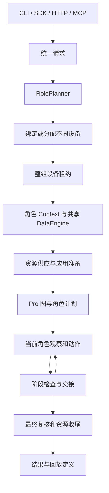

# Artemis 项目优化总体设计

本文定义 Pro 多设备执行、角色规划、Action 数据绑定和执行收尾的通用方案。长期 Case、权限、上传和批次管理见 [Case 管理设计](case-management-design.md)。运行接口中的 run_id 标识一次执行，不代替长期 case_id。

## 1. 目标与边界

一个 Case 可以包含一个或多个设备参与者。系统先识别角色，再分配不同设备，按 TaskPlan 的既定顺序串行执行，并保存角色、阶段、动作和数据来源可关联的证据。

实现复用 Pro 图、Markdown task_plan、Operator、Validator、Checker、ActionSession 和 DataEngine。角色运行时负责协调这些组件，不另建执行引擎、计划图或通用业务语义判定器。

| 能力 | 边界 |
|---|---|
| 角色规划与设备分配 | 模型解释参与者，代码检查结构与显式约束；不承诺自动证明角色语义完整 |
| 多设备执行 | 单活动角色、按阶段串行；A→B→A 表示两个角色参与三个阶段 |
| 账号供应 | 可信宿主回调对接外部资源；SDK 不代替账号服务验证身份 |
| Action 绑定 | 保存来源与依赖，在执行边界解析；不通过字符串相等猜测来源 |
| 业务输出提取 | 使用既有提取器及发布接口，包括已有 MeetingID 输出；不规定或新增提取算法 |
| 回放 | 生成并校验中间定义；不自动提炼成功路径、生成 YAML 或调度回放 |
| Case 产品管理 | 独立设计；本地租约不等于云端 Case 控制权 |

## 2. 核心对象

| 对象 | 职责与不变量 |
|---|---|
| RolePlan / RoleSpec | 本次执行的内部规划结果；description 和 assumptions 说明身份判断依据，unresolved 记录歧义；身份不按当前动作变化 |
| DeviceSpec | 角色到 serial 的绑定及可信准备信息；不同角色不能共用设备 |
| AppProfile | 显式应用包、环境说明与可选 APK；不按设备型号推测被测应用 |
| task_plan / milestone | Markdown 为权威；顶层阶段绑定一个角色，子项继承角色 |
| ExecutionScope | 固定 role、device、phase、turn、step 与阶段归属，跨异步边界传递 |
| Action | action_id 标识操作意图，attempt 标识执行尝试 |
| ValueBindings | Case 内共享定义与实际值；访问受类型、角色、确认和失效状态约束 |
| DataEngine | 一个 Run 共用的步骤、trace、检查及绑定记录 |

阶段表达业务义务，Action 表达数据生产与消费。“创建会议并让另一角色加入”通过角色阶段保持业务顺序，创建动作的 MeetingID 输出可以被后续输入引用；数据传递本身不要求额外拆分阶段。

## 3. 入口与执行链

公开请求提供 Case、可选设备绑定、应用信息、feature 目录和执行预算，不接收外部 RolePlan，也不接收可执行账号供应回调或临时凭据。RolePlan 必须由统一规划入口产生，避免不同入口绕过角色规划。

SDK 的 MultiDeviceAgent 管理完整执行生命周期。CLI `run-case` 是 JSON 请求适配器；HTTP `/api/cases` 与 MCP case 工具共同使用 jobs，经独立 worker 调用同一 CLI 和 SDK。ArtemisClient 包装 HTTP 协议。普通任务入口承担其既有排队与参数适配职责，不复制角色规划和执行逻辑。

这些入口服务不同调用环境，保留已有调用方。公共请求校验、后台 job 状态与实际执行分别只有一个实现位置，不为减少入口数量而移除可用协议。

jobs 保存请求、进度和结果；查询以 PID 和创建时间核验 worker 身份。run_id 必须为 UUID，录像路径必须位于对应执行目录。CLI 的 test_name 保存为元数据，产物仍按 run_id 建目录；traces_path 决定根目录。独立 APK 路径支持安装而不猜测包名，不能同时在顶层和 AppProfile 重复指定 APK。

## 4. 有界角色规划

RolePlanner 复用现有 Agent 的结构化输出、错误分类、重试和 fallback 机制。正常请求只需一次成功生成，不额外调用模型自审角色表。

结构、重复 ID、显式绑定集合或 feature 枚举等明确契约错误最多触发一次带错误反馈的修复。首次生成、传输重试、fallback 和契约修复共用规划 deadline。阶段预算取 Planner 已解析模型端点的 timeout_seconds，并与请求 timeout_seconds 取较小值；SDK 的外层 Case deadline 继续约束剩余总时间。未提供端点预算的适配器沿用公共 LLM 等待预算，不单设角色或模型专用时限。修复不能重置预算。取消立即终止规划。未解决的业务歧义直接停止并说明缺失信息，不通过反复生成强行得到答案。

代码能够验证角色 ID 唯一、设备绑定集合一致、需求字段合法、枚举值属于目录等约束。角色数量和身份是否忠实表达自然语言 Case 仍属于模型解释能力。case_actor 表达参与者，模型在现有 description / assumptions 中说明判断依据，unresolved 表达歧义；这些内容用于追溯判断，不是额外的强制 evidence 字段，也不构成语义正确性证明。代词、隐含参与者和“两个用户”等数量描述合法，不能以 actor 必须逐字出现于原文作为通用规则。

角色数量先于设备分配确定，不能为适应在线设备数而合并参与者。自动分配按首选设备、忙闲状态和 serial 排序；设备不足或指定设备离线直接失败。复杂硬件能力匹配不在分配器职责内。

feature 目录中的列表或带 allowed_values / values 列表的对象表示显式枚举；描述性字符串和其他映射不被猜测为取值白名单。供应器返回的实际准备情况必须满足需求，不能仅复制模型需求作为验证结果。

## 5. 账号资源与输入来源

可信 binding_preparer 在设备上下文和共享 ValueBindings 建立后运行。供应器选择并验证账号，通过 register_fixture 注册资源、字段、provider、requirements 与字段可访问角色。SDK 核验尚未由 prepared_features 证明的需求，同一角色的一个资源必须满足全部剩余需求，不能拼接不同账号属性。

已确定的 AppProfile 包名作为可信应用配置注册为各角色的 fixture 字段，供 manage_app 引用；包名不需要出现在 Case 原文中。该资源使用系统保留名称 `artemis_app_profile`，引用形如 `roles.<role>.artemis_app_profile.package`，账号供应器不得占用；只登记已有可信配置，不从 APK 猜测包名。

未配置供应器时，由调用方通过 prepared_features 提供准备证明。空供应、属性不匹配或注册角色错误在 Case 动作前失败。供应器自己持有的资源租约由供应器负责释放。

| 来源 | 绑定入口 | 安全定义 |
|---|---|---|
| Case 明确给出的固定文本 | register_case_literal / bind_case_input | 原文位置与固定值 |
| 账号等运行时资源 | register_fixture | 资源和字段引用，不含实际凭据 |
| 动作产生的业务值 | publish_action_output | 生产 Action、输出名与依赖，不含本次实际值 |

bind_case_input 校验精确原文位置，以证明文本来自 Case；它不证明该文本在业务上应当作为固定输入。引用相同字符串的不同来源仍保持不同身份。运行时字段跨角色共享必须显式授权，不从邮箱、密码等字段名称推断权限。

## 6. 输入强制绑定与输出关联

启用绑定时，Action manifest 或自定义工具契约声明的模型业务参数必须使用结构化引用 `{"ref":"..."}`，不能直接提交实际业务字符串。固定 Case 输入先登记再引用；动态值引用供应器字段或已确认的动作输出。坐标、时长等已声明控制参数仍使用标量，普通字符串中的变量样式不隐式展开。

Operator 在接受模型动作时立即检查声明的业务参数，错误反馈必须告诉模型如何使用已有引用或登记固定输入，避免无效动作进入设备执行。ActionSession 出队派发前再次校验，覆盖排队期间的值失效、角色切换及绕过前端检查的调用。

约束由绑定启用状态和可信参数声明决定，不将所有字符串一律视作业务输入。未启用绑定的 legacy 调用继续遵循原契约；MCP wire 与驱动接收解析后的标量。外部原始 wire 调用不自动获得已验证的回放来源。绑定 Case 不向 Operator 或诊断子代理暴露自由 shell 工具；工具实际执行层同时拒绝任意 ADB 命令和 manage_task.send_input，避免隐藏 schema 后仍可直接调用或通过子代理绕过。后台任务的列表、状态和终止操作保留，可信内部 driver 的准备与清理不受模型工具禁令影响。日志、UI、历史和录像等专用诊断工具继续可用。该策略不解析命令语义，legacy 非绑定执行保留原 shell 能力。强制绑定仍以可信工具的参数声明为边界，不承诺识别任意自定义工具实现中的业务语义。

ValueBindings 校验存在性、类型、角色、确认状态与失效状态，实际值仅在临近派发时解析。模型动作、队列与绑定记录保留符号参数。自定义工具通过可信 schema 或 artemis_bindings 声明业务参数，通过 artemis_literals 声明可保存的控制参数；模型不能在调用参数中修改契约。工具可以使用解析标量计算并发布输出，但嵌套调用设备动作时仍须显式传入 ValueRef。解析后的标量不自动继承来源，也不因调用来自可信工具而免除派发检查。应用准备使用可信配置，属于明确的内部边界。

工具包装器为普通函数、协程和 BaseTool.ainvoke 建立 Action 生命周期。既有提取器在该上下文发布输出，成功后确认，失败或取消后失效；模型收到输出引用。包装器外的可信生产代码使用 bound_operation。输出自动依赖输入引用，也可声明额外依赖；失效沿依赖传播，重新生产使用新 action_id，不覆盖旧值。

MeetingID 等已有输出沿用上述发布与消费关系。该方案不修改结果提取算法，不按原始值扫描历史并反向替换引用，也不自动重新执行依赖动作。

## 7. 计划顺序与角色隔离

运行时只选择书写顺序中最早未完成的 milestone，后续 active 不能绕过 pending 或 blocked 前驱。Operator 只能完成当前角色的当前阶段，必须保留已有顶层身份与相对顺序，可以添加子任务或末尾阶段。普通编辑不得删除、改名、重排既有义务，也不得自行重开已完成阶段。

明确失败的检查点和最终复核通过可信修复路径重开对应阶段，暂停后继活动阶段。用户要求改变既定顶层业务阶段需要可审计的重规划入口，不能借普通描述编辑规避顺序约束。

commit_plan 在锁内比较读取版本，校验后原子替换 Markdown 并增加 plan_revision；并发冲突要求重新读取。不引入长期计划节点 ID 迁移。

每个角色拥有独立观察、节点和历史状态，共享计划、笔记、检查与 DataEngine。阶段变化后旧回合不得继续派发动作，必须获取新观察；同一角色的连续阶段也逐项推进。handoff 前必须为每个模型 tool_call 配对结果消息，未执行动作返回明确的延期结果，防止 A→B→A 历史产生悬空调用。

TaskPlan 状态与作用域可以确定性验证；通用坐标操作的业务含义不能仅靠代码证明。关键前置条件需要写入阶段与 verify 检查，不能把计划顺序约束描述为所有业务行为的自动语义保证。

## 8. 检查与结果

检查派发时固定角色、设备、阶段、步骤和计划修订，迟到结果仍归属原位置。同文检查项通过角色与阶段区分，避免不同设备互相覆盖。

阶段交接前必须收敛相关完成检查。失败 verify 可重开原阶段；未确认的前置 verify 不能被当作成功继续跨阶段。等待必须有结算预算，过时、取消或撤销的检查按状态处理。性能调整不得以省略交接前置检查为代价。

最终复核收集标明角色的终态证据。执行完成、测试通过和 replay_ready 是三个独立判断；失败、未确认和未检查项分别保存，不互相替代。

## 9. 租约、取消与收尾

DeviceSetLease 按稳定顺序申请整组设备，一台失败即释放已持有设备并在预算内重试。全局并发按 Case/session 计算。重复取消时先等待拥有申请动作的工作线程结束，再释放它取得的锁，避免线程在清理后追加租约。

直连 ADB 的变更命令使用带总时限的客户端进程，保留服务器 host、port 和目标 serial。创建中取消仍保留进程所有权；取消或超时先结束并等待客户端，阻止多步操作继续派发。ActionSession 的终态关闭等待 owner 与队列退出，普通调用方超时不破坏可继续使用的 transport。

设备、录像、后台检查和 ADB 任务在租约内收尾。录像在可取消启动前登记清理责任；部分初始化失败也清理已取得资源。回放校验与结果保存不能跳过引擎关闭，DataEngine 收尾后清除运行时值。

终止保证限于本进程拥有的客户端和租约，不涵盖设备端自行脱离的进程。云网关、自定义 provider 的线程传输保留原超时契约，但不具备直连客户端的终止保证；只读设备 I/O 也不应被声称全部可强制终止。

## 10. 证据与回放定义

DataEngine 在现有 trace 中记录 action_binding，包含 action_id、attempt、符号输入、输出引用、执行状态、作用域和安全定义快照。日志以 run、role、device、turn、step、阶段和 action 关联；异步日志生产时捕获上下文，消费时恢复。

回放投影只接受声明字段，校验来源、类型、角色、成功状态、生产消费顺序和依赖。未知字段不复制，未证明来源的业务输入标记 unresolved。失败、跳过、拦截与取消的尝试保持可见，不自动删去以制造 replay_ready。

原始 LLM trace、截图、OCR、录屏和自由笔记不直接进入安全定义。可信供应器与提取器仍须避免在名称、描述、需求和日志中暴露实际值；安全投影不等于所有原始证据均已脱敏。

## 11. 六项设计原则的落点

| 原则 | 本方案的实践 |
|---|---|
| 单一职责 | RolePlanner 解释参与者，allocator 分配设备，lease 管理占有，runtime 路由，bindings 管理来源 |
| 开闭原则 | 通过可信供应器、输出发布与工具契约接入业务，不在通用流程写账号或 MeetingID 专用逻辑 |
| 里氏替换 | 保持 driver、工具和入口既有调用契约；新增取消保证明确区分直连与 provider 能力 |
| 接口隔离 | 公共请求仅承载可序列化配置，宿主回调、运行时实际值和 wire 标量使用各自接口 |
| 依赖倒置 | 复用模型路由、Action 声明、设备 driver 和 DataEngine 边界，不依赖具体 App 或账号服务 |
| 最少知识 | 角色通过作用域与受控引用协作，不共享其他设备坐标，不读取其他角色私有凭据 |

原则用于约束必要变化，不要求拆出新的框架、全面重构入口或扩展当前功能范围。

## 12. 验收与限制

验收覆盖正常单次规划、契约修复上限、共享预算、业务歧义停止、public RolePlan 拒绝、角色顺序与失败重开、A→B→A 历史、租约重复取消、设备清理、强制引用及派发再校验、失败输出失效、已有输出消费与安全投影。

质量检查使用全仓 lint、format 和既有 quality ratchet。质量基线不是可随实现增长的配额；失败需区分格式、确定缺陷与必要边界处理，不通过刷新基线或机械收窄异常掩盖问题。

自动化验证不替代真实 App、账号服务和既有提取器的联调。UI 定位在后续版本中的稳定性、复杂设备能力匹配、成功路径提炼、长期 Case 控制与上传不属于当前执行机制的保证。
