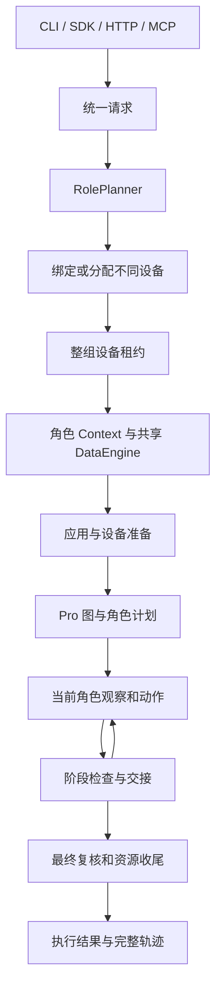

# Artemis 项目优化总体设计

本文定义 Pro 多设备执行、角色规划、执行证据和资源收尾的通用方案。长期 Case、权限、上传和批次管理见 [Case 管理设计](case-management-design.md)。运行接口中的 run_id 标识一次执行，不代替长期 case_id。

## 1. 目标与边界

一个 Case 可以包含一个或多个设备参与者。系统先识别角色，再分配不同设备，按 TaskPlan 的既定顺序串行执行，并保存角色、阶段、动作和结果可关联的证据。

实现复用 Pro 图、Markdown task_plan、Operator、Validator、Checker、ActionSession 和 DataEngine。角色运行时负责协调这些组件，不另建执行引擎、计划图或通用业务语义判定器。

| 能力 | 边界 |
|---|---|
| 角色规划与设备分配 | 模型解释参与者，代码检查结构与显式约束；不承诺自动证明角色语义完整 |
| 多设备执行 | 单活动角色、按阶段串行；A→B→A 表示两个角色参与三个阶段 |
| 设备与账号准备 | 调用方提供 account_ref 和 prepared_features；SDK 检查显式准备条件，不代替账号服务验证身份 |
| Action 输入输出 | 使用工具既有参数和返回值；探索不要求登记数据来源或使用结构化引用 |
| 业务输出提取 | 沿用现有工具、笔记和提取能力；不规定或新增业务提取算法 |
| 产物导出 | 独立消费完整执行证据；当前执行入口不生成 YAML、不推断数据依赖或调度回放 |
| Case 产品管理 | 独立设计；本地租约不等于云端 Case 控制权 |

## 2. 核心对象

| 对象 | 职责与不变量 |
|---|---|
| RolePlan / RoleSpec | 本次执行的内部规划结果；description 和 assumptions 说明身份判断依据，unresolved 记录歧义；身份不按当前动作变化 |
| DeviceSpec | 角色到 serial 的绑定及可信准备信息；不同角色不能共用设备 |
| AppProfile | 显式应用包、环境说明与可选 APK；不按设备型号推测被测应用 |
| task_plan / milestone | Markdown 为权威；顶层阶段绑定一个角色，子项继承角色 |
| ExecutionScope | 固定 role、device、phase、turn、step 与阶段归属，跨异步边界传递 |
| Action | 工具声明定义输入，工具返回值和执行结果描述本次操作 |
| DataEngine | 一个 Run 共用的步骤、trace、截图与检查记录 |

阶段表达业务义务，Action 执行具体操作。“创建会议并让另一角色加入”通过角色阶段保持业务顺序，已提取的 MeetingID 可以通过工具结果和共享笔记传递给后续角色；执行层不为业务数据建立注册、解析或依赖传播协议。

## 3. 入口与执行链

公开请求提供 Case、可选设备绑定、应用信息、feature 目录和执行预算，不接收外部 RolePlan，也不接收可执行账号供应回调或临时凭据。RolePlan 必须由统一规划入口产生，避免不同入口绕过角色规划。

SDK 的 MultiDeviceAgent 管理完整执行生命周期。CLI `run-case` 是 JSON 请求适配器；HTTP `/api/cases` 与 MCP case 工具共同使用 jobs，经独立 worker 调用同一 CLI 和 SDK。ArtemisClient 包装 HTTP 协议。普通任务入口承担其既有排队与参数适配职责，不复制角色规划和执行逻辑。

这些入口服务不同调用环境，保留已有调用方。公共请求校验、后台 job 状态与实际执行分别只有一个实现位置，不为减少入口数量而移除可用协议。

jobs 保存请求、进度和结果；查询以 PID 和创建时间核验 worker 身份。run_id 必须为 UUID，录像路径必须位于对应执行目录。CLI 的 test_name 保存为元数据，产物仍按 run_id 建目录；traces_path 决定根目录。独立 APK 路径支持安装而不猜测包名，不能同时在顶层和 AppProfile 重复指定 APK。

## 4. 有界角色规划

RolePlanner 复用现有 Agent 的结构化输出、错误分类、重试和 fallback 机制。正常请求只需一次成功生成，不额外调用模型自审角色表。

结构、重复 ID、显式绑定集合或 feature 枚举等明确契约错误最多触发一次带错误反馈的修复。首次生成、传输重试、fallback 和契约修复共用规划 deadline。阶段预算取 Planner 已解析模型端点的 timeout_seconds，并与请求 timeout_seconds 取较小值；SDK 的外层 Case deadline 继续约束剩余总时间。未提供端点预算的适配器沿用公共 LLM 等待预算，不单设角色或模型专用时限。修复不能重置预算。取消立即终止规划。未解决的业务歧义直接停止并说明缺失信息，不通过反复生成强行得到答案。

代码能够验证角色 ID 唯一、设备绑定集合一致、需求字段合法、枚举值属于目录等约束。角色数量和身份是否忠实表达自然语言 Case 仍属于模型解释能力。case_actor 表达参与者，模型在现有 description / assumptions 中说明判断依据，unresolved 表达歧义；这些内容用于追溯判断，不是额外的强制 evidence 字段，也不构成语义正确性证明。代词、隐含参与者和“两个用户”等数量描述合法，不能以 actor 必须逐字出现于原文作为通用规则。

角色数量先于设备分配确定，不能为适应在线设备数而合并参与者。自动分配按首选设备、忙闲状态和 serial 排序；设备不足或指定设备离线直接失败。复杂硬件能力匹配不在分配器职责内。

feature 目录中的列表或带 allowed_values / values 列表的对象表示显式枚举；描述性字符串和其他映射不被猜测为取值白名单。调用方提供的准备信息必须满足角色需求，不能仅复制模型需求作为验证结果。

## 5. 设备准备与应用配置

DeviceSpec 的 account_ref 表达账号身份约束，prepared_features 表达调用方已经完成的设备或账号准备情况。SDK 在 Case 动作前检查角色需求是否全部满足，缺失或不匹配时直接失败；不内置账号供应服务，不通过 Action 数据注册表证明准备状态。

AppProfile 提供明确的包名、环境说明和可选 APK，应用准备直接使用该配置。包名不需要出现在 Case 原文中，也不需要注册为动作输入引用。账号分配、凭据注入及外部资源租约由宿主既有机制负责。

## 6. Action 参数与工具结果

Operator、Validator、ActionSession 和 MCP 使用既有工具参数契约。文本输入、应用包名等业务参数直接使用字符串；坐标和时长等控制参数使用各自声明的类型。普通字符串中的变量样式不隐式展开。

工具包装器负责参数注入、调用和 trace 记录，向模型返回真实工具结果，不把业务返回值改写成注册表引用。自定义工具和现有提取能力使用相同调用接口；跨角色所需的已确认事实可写入共享笔记，其他设备的坐标不能复用。

模型仍可使用既有 shell 和诊断工具。工具可用性、设备权限与角色作用域遵循各自的独立执行约束，不以数据来源登记状态作为开关。文本输入的设备反馈不回显输入明文；普通轨迹、截图和自由笔记不构成已脱敏数据保证。

## 7. 计划顺序与角色隔离

运行时只选择书写顺序中最早未完成的 milestone，后续 active 不能绕过 pending 或 blocked 前驱。Operator 只能完成当前角色的当前阶段，必须保留已有顶层身份与相对顺序，可以添加子任务或末尾阶段。普通编辑不得删除、改名、重排既有义务，也不得自行重开已完成阶段。

明确失败的检查点和最终复核通过可信修复路径重开对应阶段，暂停后继活动阶段。用户要求改变既定顶层业务阶段需要可审计的重规划入口，不能借普通描述编辑规避顺序约束。

commit_plan 在锁内比较读取版本，校验后原子替换 Markdown 并增加 plan_revision；并发冲突要求重新读取。不引入长期计划节点 ID 迁移。

每个角色拥有独立观察、节点和历史状态，共享计划、笔记、检查与 DataEngine。阶段变化后旧回合不得继续派发动作，必须获取新观察；同一角色的连续阶段也逐项推进。handoff 前必须为每个模型 tool_call 配对结果消息，未执行动作返回明确的延期结果，防止 A→B→A 历史产生悬空调用。

TaskPlan 状态与作用域可以确定性验证；通用坐标操作的业务含义不能仅靠代码证明。关键前置条件需要写入阶段与 verify 检查，不能把计划顺序约束描述为所有业务行为的自动语义保证。

## 8. 检查与结果

检查派发时固定角色、设备、阶段、步骤和计划修订，迟到结果仍归属原位置。同文检查项通过角色与阶段区分，避免不同设备互相覆盖。

阶段交接前必须收敛相关完成检查。失败 verify 可重开原阶段；未确认的前置 verify 不能被当作成功继续跨阶段。等待必须有结算预算，过时、取消或撤销的检查按状态处理。性能调整不得以省略交接前置检查为代价。

最终复核收集标明角色的终态证据。执行完成与测试通过分别保存；失败、未确认和未检查项不互相替代。执行结果不附加绑定投影的就绪状态。

## 9. 租约、取消与收尾

DeviceSetLease 按稳定顺序申请整组设备，一台失败即释放已持有设备并在预算内重试。全局并发按 Case/session 计算。重复取消时先等待拥有申请动作的工作线程结束，再释放它取得的锁，避免线程在清理后追加租约。

直连 ADB 的变更命令使用带总时限的客户端进程，保留服务器 host、port 和目标 serial。创建中取消仍保留进程所有权；取消或超时先结束并等待客户端，阻止多步操作继续派发。ActionSession 的终态关闭等待 owner 与队列退出，普通调用方超时不破坏可继续使用的 transport。

设备、录像、后台检查和 ADB 任务在租约内收尾。录像在可取消启动前登记清理责任；部分初始化失败也清理已取得资源。结果保存不能跳过引擎关闭，DataEngine 等待后台写入结束后完成收尾。

终止保证限于本进程拥有的客户端和租约，不涵盖设备端自行脱离的进程。云网关、自定义 provider 的线程传输保留原超时契约，但不具备直连客户端的终止保证；只读设备 I/O 也不应被声称全部可强制终止。

## 10. 执行证据与产物边界

DataEngine 通过现有步骤、工具 trace、执行结果、截图和检查记录保存探索过程。记录通过 run、role、device、turn、step 和阶段关联；异步日志生产时捕获上下文，消费时恢复。执行层不新增 Action 输入输出绑定记录或依赖传播协议。

成功后的 YAML 整理由独立产物流程消费这些证据，不作为探索动作的前置条件。消费方需要等待轨迹写入完整，并以 Case 级视角读取所有角色，避免当前角色的历史过滤遗漏其他设备记录。

探索轨迹包含失败尝试、诊断和重试，不能直接等同于成功回放脚本。产物流程需要区分成功路径、必要准备、固定输入与动态值；缺少记录的来源关系不能仅凭字符串相等推断。执行入口当前不实现 YAML 生成或回放调度，也不把产物可用性视为探索成功条件。

## 11. 六项设计原则的落点

| 原则 | 本方案的实践 |
|---|---|
| 单一职责 | RolePlanner 解释参与者，allocator 分配设备，lease 管理占有，runtime 路由，DataEngine 记录执行证据 |
| 开闭原则 | 通过既有工具契约和外部产物流程接入业务，不在通用执行流程写账号或 MeetingID 专用逻辑 |
| 里氏替换 | 保持 driver、工具和入口既有调用契约；新增取消保证明确区分直连与 provider 能力 |
| 接口隔离 | 公共请求承载可序列化的 Case 与设备配置，工具参数、执行结果与产物处理保持各自接口 |
| 依赖倒置 | 复用模型路由、Action 声明、设备 driver 和 DataEngine 边界，不依赖具体 App 或账号服务 |
| 最少知识 | 角色通过作用域和必要共享事实协作，不共享其他设备坐标，执行层不依赖业务数据注册表 |

原则用于约束必要变化，不要求拆出新的框架、全面重构入口或扩展当前功能范围。

## 12. 验收与限制

验收覆盖正常单次规划、契约修复上限、共享预算、业务歧义停止、public RolePlan 拒绝、设备准备条件、角色顺序与失败重开、A→B→A 历史、旧轮次动作拒绝、租约重复取消、设备清理、普通参数输入、工具结果透传与完整轨迹记录。

质量检查使用全仓 lint、format 和既有 quality ratchet。质量基线不是可随实现增长的配额；失败需区分格式、确定缺陷与必要边界处理，不通过刷新基线或机械收窄异常掩盖问题。

自动化验证不替代真实 App、账号服务和既有提取器的联调。UI 定位在后续版本中的稳定性、复杂设备能力匹配、成功路径提炼、长期 Case 控制与上传不属于当前执行机制的保证。
